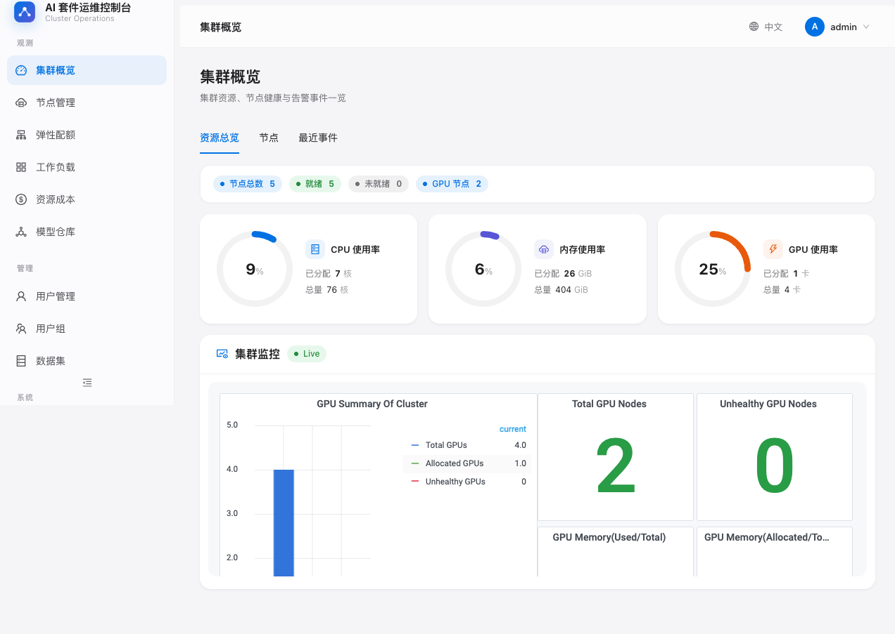
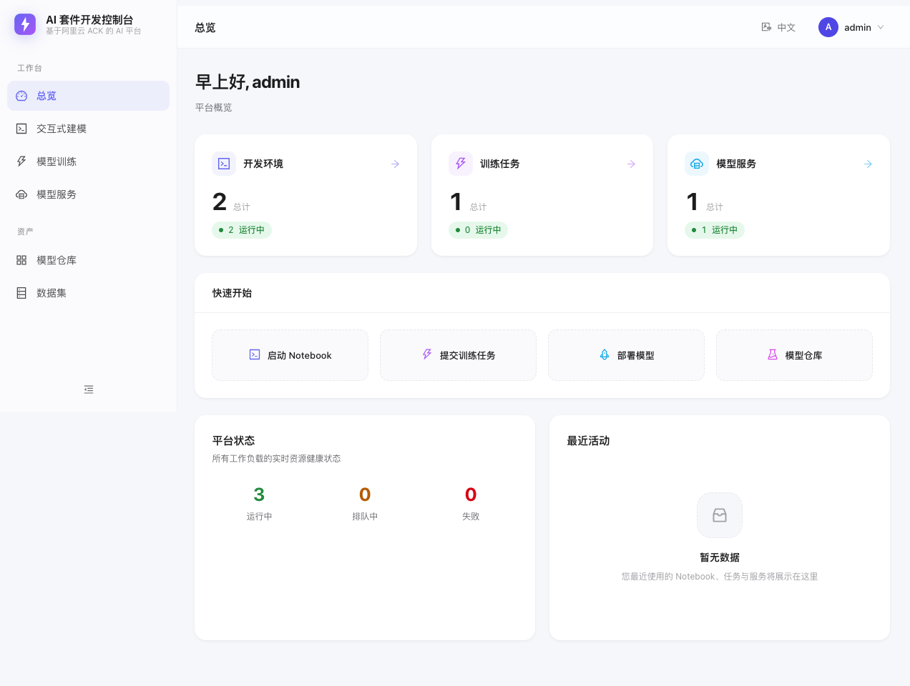
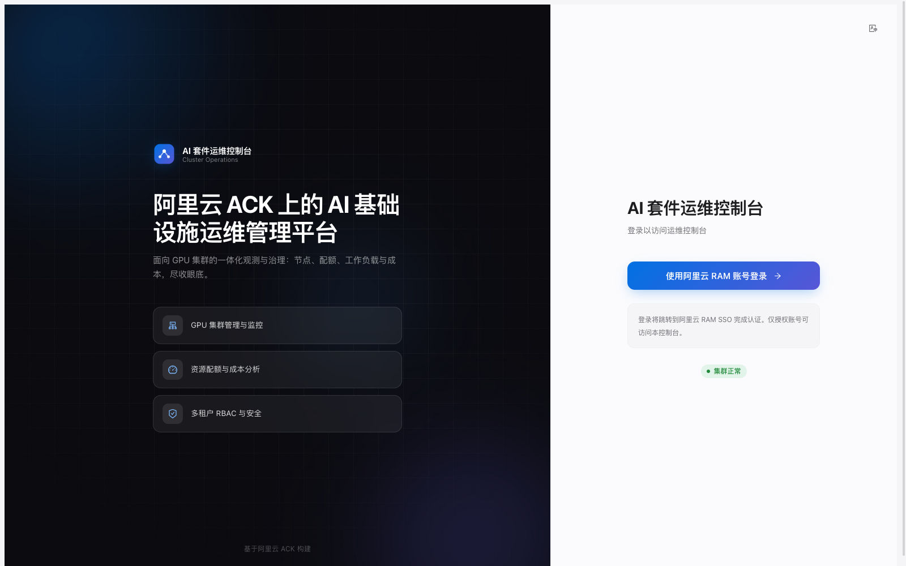

# 部署指南：在 ACK 上安装 AI 开发平台

本文介绍如何在阿里云容器服务 ACK（Kubernetes）集群上部署 data-on-ack AI 开发平台，包含**运维控制台（ai-dashboard）**和**开发控制台（ai-dev-console）**，以及配套的 notebook-controller、commit-agent 和内置监控。

按照本文「快速开始」操作，**无需任何阿里云凭据即可在十几分钟内部署出一套可用环境**（免登录模式）。生产环境请改用阿里云 RAM SSO 或自定义用户系统（见[认证模式](#auth-modes)）。

## 架构概览

```
                    ┌──────────────────────────────────────────┐
                    │            ACK Pro Cluster               │
                    │                                          │
  用户浏览器 ──────▶│  Nginx Ingress Controller (SLB)          │
                    │    ├── ai-dashboard.example.com          │
                    │    │      → ai-dashboard (:8080)         │
                    │    └── ai-dev.example.com                │
                    │           → ai-dev-console (:9090)       │
                    │                                          │
                    │  ai-dashboard（运维控制台）               │
                    │    ├── 集群概览 / 节点运维 (Node Shell)   │
                    │    ├── 用户 / 用户组 / 弹性配额管理        │
                    │    ├── 数据集 / 模型仓库 / 平台设置        │
                    │    └── Grafana 监控面板                   │
                    │                                          │
                    │  ai-dev-console（开发控制台）             │
                    │    ├── Notebook (JupyterLab / VS Code)    │
                    │    ├── 训练任务 (PyTorch/TF/MPI/Ray)      │
                    │    ├── 模型推理服务 + API Playground      │
                    │    └── 数据集 / 模型仓库                  │
                    │                                          │
                    │  notebook-controller · commit-agent     │
                    │  Prometheus（内置监控，可选 ARMS）        │
                    └──────────────────────────────────────────┘
```

## 前提条件

| 条件 | 说明 |
|------|------|
| ACK Pro 集群 | Kubernetes >= 1.20，`kubectl` 已配置 kubeconfig 连接集群 |
| Helm 3+ | 本地已安装 helm CLI（Helm 4 亦可，见[常见问题](#faq)） |
| Nginx Ingress Controller | 集群已安装，用于暴露控制台（安装方法见[步骤一](#step-ingress)） |
| 云原生 AI 套件 / ack-arena | 提供训练 operator 与 `arena_*` 监控指标（ACK 控制台「应用 > 云原生 AI 套件」一键安装） |
| 阿里云账号（仅 aliyun 模式） | 免登录模式无需；RAM SSO 模式需主账号或具 RAM/IMS 权限的子账号 |

> **说明**：监控默认使用 chart 内置的集群内 Prometheus，**无需预先开通 ARMS**。如需对接 ARMS Prometheus，见[监控配置](#monitoring)。

## 快速开始（免登录，开箱即用）

默认认证模式为 `none`（免登录）：所有请求以内置 `admin` 身份运行，拥有全部权限。chart 会**自动完成**以下初始化，无需手工配置：

- 创建 admin ServiceAccount、token Secret 及 cluster-admin 绑定（开发控制台据此提交 Notebook/训练/推理任务）；
- 部署集群内 Prometheus 并接入 Grafana，监控面板开箱出数；
- 写入 AC2 默认开发镜像（`kubeai-platform-config`）；
- 若集群没有默认 StorageClass，自动将 `alicloud-disk-topology-alltype` 标记为默认（Notebook 工作空间 PVC 依赖默认 StorageClass）。

> ⚠️ **安全提示**：`none` 模式下任何能访问控制台地址的人都拥有全部权限。仅适用于内网、PoC 或已有外层访问控制的环境。公网暴露时务必为 SLB/Ingress 配置访问控制（ACL 白名单或改用内网 SLB），生产环境请改用 `aliyun` 或 `custom` 模式。

### 步骤一：安装 Nginx Ingress Controller {#step-ingress}

若集群尚未安装，二选一：

**方式 A（推荐，ACK 组件）**：ACK 控制台 → 集群 → 组件管理 → 搜索 `nginx-ingress-controller` → 安装。安装后 SLB Service 为 `kube-system/nginx-ingress-lb`。

**方式 B（社区 Helm chart）**：

```bash
helm repo add ingress-nginx https://kubernetes.github.io/ingress-nginx
helm repo update
helm install ingress-nginx ingress-nginx/ingress-nginx \
  -n ingress-nginx --create-namespace
```

安装后 SLB Service 为 `ingress-nginx/ingress-nginx-controller`。

> 无公网出口的集群需将 ingress-nginx 镜像同步到可达仓库后再安装，见[离线/跨地域集群部署](#offline-deploy)。

### 步骤二：安装两个控制台

```bash
kubectl create namespace kube-ai

# 运维控制台（release 名必须为 ack-ai-dashboard，见下方说明）
helm install ack-ai-dashboard charts/ack-ai-dashboard -n kube-ai \
  --set grafana.adminPassword='<GRAFANA_PASSWORD>' \
  --set 'admin-ui.dashboard.ingress.hosts[0].host=ai-dashboard.example.com' \
  --set 'admin-ui.dashboard.ingress.hosts[0].paths[0]=/'

# 开发控制台
helm install ack-ai-dev-console charts/ack-ai-dev-console -n kube-ai \
  --set 'dev-console.console.ingress.hosts[0].host=ai-dev.example.com' \
  --set 'dev-console.console.ingress.hosts[0].paths[0]=/'
```

> **release 名说明**：运维控制台请使用 release 名 `ack-ai-dashboard`，使其 Grafana 反向代理目标（默认 `ack-ai-dashboard-grafana.kube-ai:80`）正确解析。若使用其他 release 名，需同步设置 `admin-ui.dashboard.grafanaProxyTarget`。

**关键参数：**

| 参数 | 必填 | 说明 |
|------|------|------|
| `grafana.adminPassword` | 是 | Grafana 管理员密码（自定义强密码） |
| `admin-ui.dashboard.ingress.hosts[0].host` | 是 | 运维控制台域名 |
| `dev-console.console.ingress.hosts[0].host` | 是 | 开发控制台域名 |
| `admin-ui.auth.mode` / `dev-console.auth.mode` | 否 | 认证模式，默认 `none`，见[认证模式](#auth-modes) |
| `prometheus.enabled` | 否 | 内置 Prometheus，默认 `true` |

### 步骤三：配置域名解析

获取 Ingress SLB 的公网 IP（按步骤一的安装方式选择对应命令）：

```bash
# 方式 A（ACK 组件）
kubectl get svc -n kube-system nginx-ingress-lb \
  -o jsonpath='{.status.loadBalancer.ingress[0].ip}'

# 方式 B（社区 chart）
kubectl get svc -n ingress-nginx ingress-nginx-controller \
  -o jsonpath='{.status.loadBalancer.ingress[0].ip}'
```

在本地 `/etc/hosts` 添加（测试用；生产建议在企业 DNS / PrivateZone 配置解析）：

```
<SLB_IP> ai-dashboard.example.com
<SLB_IP> ai-dev.example.com
```

### 步骤四：访问与验证

```bash
kubectl get pods -n kube-ai
# 期望：admin-ui、ai-dev-console、grafana、notebook-controller、prometheus-server 均 Running，
#       commit-agent DaemonSet 在每个节点 Running

curl -s -o /dev/null -w '%{http_code}\n' http://ai-dashboard.example.com/health   # 期望 200
curl -s -o /dev/null -w '%{http_code}\n' http://ai-dev.example.com/health        # 期望 200
```

浏览器打开：

- 运维控制台：`http://ai-dashboard.example.com/`
- 开发控制台：`http://ai-dev.example.com/`

免登录模式下直接进入控制台首页（内置 admin）。建议逐项验证核心能力，见[验证清单](#verification)。





## 认证模式 {#auth-modes}

两个控制台支持三种认证模式，通过 Helm 参数 `auth.mode`（或环境变量 `AUTH_MODE`）选择：

| 模式 | 说明 | 是否需要阿里云 AK/SK |
|------|------|---------------------|
| `none`（默认） | 免登录，所有请求以内置 admin 身份运行，拥有全部权限，部署即可用 | 否 |
| `aliyun` | 阿里云 RAM OAuth2 SSO 登录，主账号自动为 admin | 是 |
| `custom` | 接入客户自定义用户系统：信任上游网关注入的身份请求头 | 否 |

### 免登录模式（none，默认）

即「快速开始」所用模式，无需任何额外配置。chart 自动 provision admin 身份，所有访问者均为 admin。

> ⚠️ 仅限内网/PoC 或已有外层访问控制的环境；公网暴露务必加访问控制。

### 阿里云 RAM SSO（aliyun，生产推荐）

切换到 aliyun 模式需完成 RAM 授权、创建凭据 Secret，再升级两个 release。

**1. 创建 RAM 权限策略**（RAM 控制台 → 权限策略 → 创建策略，名称如 `k8sWorkerRolePolicy-<ClusterID>`）：

```json
{
  "Version": "1",
  "Statement": [
    {
      "Effect": "Allow",
      "Action": [
        "ims:CreateApplication", "ims:UpdateApplication", "ims:GetApplication",
        "ims:ListApplications", "ims:DeleteApplication", "ims:CreateAppSecret",
        "ims:GetAppSecret", "ims:ListAppSecretIds", "ims:ListUsers"
      ],
      "Resource": "*"
    }
  ]
}
```

**2. 为集群 Worker 角色授权**：RAM 控制台 → 角色 → 搜索 `KubernetesWorkerRole-<ClusterID>` → 添加上述策略。（使用 RRSA 时改为对 ServiceAccount 绑定的 RAM Role 授权。）

**3. 获取 AccessKey 并创建 Secret**（推荐仅授予 IMS 权限的 RAM 子账号 AK）：

```bash
kubectl create secret generic ai-dashboard-credentials -n kube-ai \
  --from-literal=accessKeyId=<AK> --from-literal=accessKeySecret=<SK>
kubectl create secret generic ai-dev-console-credentials -n kube-ai \
  --from-literal=accessKeyId=<AK> --from-literal=accessKeySecret=<SK>

# 可选：Session 持久化（Pod 重启后会话不丢失）
kubectl create secret generic ai-dashboard-auth -n kube-ai \
  --from-literal=sessionSecret=$(openssl rand -hex 32)
kubectl create secret generic ai-dev-console-auth -n kube-ai \
  --from-literal=sessionSecret=$(openssl rand -hex 32)
```

**4. 升级到 aliyun 模式**：

```bash
helm upgrade ack-ai-dashboard charts/ack-ai-dashboard -n kube-ai --reuse-values \
  --set admin-ui.auth.mode=aliyun \
  --set admin-ui.auth.existingSecret=ai-dashboard-auth

helm upgrade ack-ai-dev-console charts/ack-ai-dev-console -n kube-ai --reuse-values \
  --set dev-console.auth.mode=aliyun \
  --set dev-console.auth.existingSecret=ai-dev-console-auth
```

控制台启动时会自动通过 IMS API 创建 RAM OAuth2 Web 应用并设置回调地址：

- 运维控制台：`http://<YOUR_DASHBOARD_DOMAIN>/login/aliyun`
- 开发控制台：`http://<YOUR_CONSOLE_DOMAIN>/api/v1/login/aliyun/callback`

首次访问重定向到阿里云 RAM SSO 登录页：**主账号登录**自动获得 admin，**RAM 子账号登录**获得 researcher。如需手动管理 OAuth 应用，参阅[创建 RAM OAuth 应用](https://help.aliyun.com/zh/ram/create-an-application)（设 `createWebApp: false` 时需手动创建并配置回调）。



### 自定义用户系统（custom）

控制台信任上游网关（企业 SSO / API Gateway）完成认证后注入的 HTTP 请求头：

| 配置（Helm `auth.custom.*` / 环境变量） | 默认 | 说明 |
|------|------|------|
| `userHeader` / `AUTH_USER_HEADER` | `X-Forwarded-User` | 认证后的用户名（必需） |
| `groupsHeader` / `AUTH_GROUPS_HEADER` | `X-Forwarded-Groups` | 用户组列表，逗号分隔（可选） |
| `adminUsers` / `AUTH_ADMIN_USERS` | 空 | 授予 admin 角色的用户名列表（逗号分隔） |
| `adminGroups` / `AUTH_ADMIN_GROUPS` | 空 | 授予 admin 角色的用户组列表（逗号分隔） |
| `loginUrl` / `AUTH_LOGIN_URL` | 空 | 未认证浏览器请求的重定向地址（如企业 SSO 登录页） |

接入方职责：网关在转发到控制台之前必须完成认证，注入上述请求头，并**剥离客户端伪造的同名请求头**。开发控制台中，用户的命名空间权限仍由平台 User CRD 决定；未匹配 CRD 且不在 admin 列表中的用户为 researcher 角色。

```bash
helm upgrade ack-ai-dev-console charts/ack-ai-dev-console -n kube-ai --reuse-values \
  --set dev-console.auth.mode=custom \
  --set dev-console.auth.custom.userHeader=X-Forwarded-User \
  --set dev-console.auth.custom.adminGroups=platform-admins \
  --set dev-console.auth.custom.loginUrl=https://sso.example.com/login
```

**custom 模式行为说明：**

- K8s Token 登录（`/api/v1/login/token`）在 custom 模式下被禁用，防止绕过企业 IdP；
- 用户角色与命名空间权限每次请求实时查询 User CRD，权限变更立即生效；
- 未认证请求：浏览器跳转 `loginUrl`（若配置），API 返回 401 且响应体携带 `loginUrl`；
- 反向代理路由（Notebook/VSCode/TensorBoard/Ray Dashboard）同样走头认证与命名空间校验，含 WebSocket 通道；
- 请确保控制台 Service 不直接对外暴露，仅经网关访问。

## 监控配置 {#monitoring}

### 默认：集群内 Prometheus（开箱即用）

chart 默认部署集群内 Prometheus（`prometheus.enabled=true`），采集 `arena-exporter`（`arena_*` 指标）与 ARMS GPU exporter（`nvidia_gpu_*` 指标），并自动接入 Grafana。**无需开通 ARMS，监控面板即有数据。**

### 可选：对接 ARMS Prometheus

如需使用 ARMS Prometheus（保留托管存储与历史数据）：

1. ACK 控制台 → 集群 → 运维管理 → Prometheus 监控 → 设置，复制 **HTTP API 地址（内网）**，格式：
   `http://cn-<region>-intranet.arms.aliyuncs.com:9090/api/v1/prometheus/<实例ID>/<主账号UID>/<集群ID>/<region>`
2. 关闭内置 Prometheus 并指向 ARMS：

```bash
helm upgrade ack-ai-dashboard charts/ack-ai-dashboard -n kube-ai --reuse-values \
  --set prometheus.enabled=false \
  --set 'grafana.datasources.datasources\.yaml.datasources[0].url=<ARMS内网地址>'
```

> 该地址第一段为账号级实例 token，同账号同地域可复用。不配置 ARMS 时保持默认内置 Prometheus 即可。

## 离线/跨地域集群部署 {#offline-deploy}

chart 默认镜像仓库为 `registry-cn-hangzhou.ack.aliyuncs.com/acs/`，开发镜像默认使用公共 **AC2 容器镜像**（`ac2-registry.cn-hangzhou.cr.aliyuncs.com/ac2/`，专为 ACK AI 套件设计）。若节点无公网出口或跨地域无法直拉：

**1. 同步镜像到可达仓库**（在有公网的机器上，用 [crane](https://github.com/google/go-containerregistry/tree/main/cmd/crane) 复制到你的 ACR）：

```bash
# 控制台/控制器/agent 镜像
crane copy registry-cn-hangzhou.ack.aliyuncs.com/acs/ai-dashboard:v3.3.0 \
  registry-vpc.cn-beijing.aliyuncs.com/<ns>/ai-dashboard:v3.3.0
# ai-dev-console:v3.2.0、commit-agent:v0.2.0、notebook-controller:v1.1.0、
# grafana:7.3.5、curl:7.80.0、prometheus:v2.54.1-9090eb1-aliyun、kubeai-tools:v1.2.0 同理

# AC2 开发镜像（Notebook/训练用）
crane copy ac2-registry.cn-hangzhou.cr.aliyuncs.com/ac2/jupyter:4.0.5-3.2304 \
  registry-vpc.cn-beijing.aliyuncs.com/<ns>/jupyter:4.0.5-3.2304
# jupyter-pytorch-cuda、vscode、pytorch 等按需同步
```

**2. 安装时覆盖控制台镜像仓库，并配置 AC2 镜像前缀映射**（运行时自动重写内置开发镜像地址）：

```bash
helm install ack-ai-dev-console charts/ack-ai-dev-console -n kube-ai \
  --set dev-console.image.repository=registry-vpc.cn-beijing.aliyuncs.com/<ns>/ai-dev-console \
  --set dev-console.image.commitAgentImageName=registry-vpc.cn-beijing.aliyuncs.com/<ns>/commit-agent \
  --set notebook.image.repository=registry-vpc.cn-beijing.aliyuncs.com/<ns>/notebook-controller \
  --set 'dev-console.imageRewrites[0].from=ac2-registry.cn-hangzhou.cr.aliyuncs.com/ac2/' \
  --set 'dev-console.imageRewrites[0].to=registry-vpc.cn-beijing.aliyuncs.com/<ns>/' \
  --set 'dev-console.console.ingress.hosts[0].host=ai-dev.example.com'
```

运维控制台同理覆盖 `admin-ui.image.repository`、`grafana.image.repository`、`prometheus.image.repository` 等。

## 自行构建镜像（可选）

预构建镜像已发布在 `registry-cn-hangzhou.ack.aliyuncs.com/acs/`。如需自行构建（例如修复依赖 CVE），仓库提供 Dockerfile：

```bash
# 运维控制台
cd ai-dashboard && docker build -t <your-registry>/ai-dashboard:<tag> .
# 开发控制台
cd ai-dev-console && docker build -f Dockerfile.console-new -t <your-registry>/ai-dev-console:<tag> .
```

> 建议使用最新 Go 工具链（>= 1.27.4）并以静态编译（`CGO_ENABLED=0`）+ 精简基础镜像构建，以消除 OS 与 stdlib 层 CVE。安装时通过 `--set <component>.image.repository/tag` 指定自建镜像。

## 验证清单 {#verification}

部署完成后，建议逐项验证核心能力：

| 能力 | 验证方式 |
|------|----------|
| 控制台健康 | 两个 `/health` 返回 200 |
| 集群监控 | 运维控制台「集群概览」Grafana 面板有 CPU/内存/GPU 数据 |
| 节点运维 | 「节点管理」对节点执行 Shell 命令（如 `nvidia-smi -L`）有输出 |
| 弹性配额 | 「弹性配额」初始化默认配额树并编辑节点 min/max |
| 用户管理 | 创建 researcher 用户，下载 kubeconfig，验证命名空间权限边界 |
| Notebook | 开发控制台创建 JupyterLab / VS Code Notebook，进入 IDE |
| 训练任务 | 提交 PyTorch 训练任务，查看日志直至 Succeeded |
| 推理服务 | 部署推理服务，用 API Playground 发送请求查看原始响应 |
| 模型仓库 | 从训练产物注册模型，查看版本与血缘 |

## 常见问题 {#faq}

### Q: Helm 安装报 CRD 冲突（`conflicts with "ack-kdm"`）
A: 集群已安装云原生 AI 套件时，`elasticquotatrees` 等 CRD 已被 `ack-kdm` 管理。Helm 4 使用 server-side apply 会冲突；schema 一致时加 `--force-conflicts` 接管即可：
```bash
helm install ack-ai-dashboard charts/ack-ai-dashboard -n kube-ai --force-conflicts ...
```

### Q: Pod 启动报 `failed to init credential provider`
A: 仅 `aliyun` 模式需要凭据。检查 Secret `ai-dashboard-credentials` / `ai-dev-console-credentials` 是否在 `kube-ai` 下且键名为 `accessKeyId`/`accessKeySecret`。`none` 模式不应出现此错误（确认 `auth.mode` 设置正确）。

### Q: 访问域名返回 404
A: 检查 Nginx Ingress Controller 是否安装、Ingress 是否生效：`kubectl get ingress -n kube-ai`，并确认 `/etc/hosts` 指向正确的 SLB IP。

### Q: Grafana 面板无数据
A: 默认使用内置 Prometheus，确认 `prometheus-server` Pod Running 且集群已安装 ack-arena（提供 `arena_*` 指标）。若改用 ARMS，确认内网地址正确且集群已开启 ARMS Prometheus。

### Q: Notebook Pod 一直 Pending
A: 工作空间 PVC 需要默认 StorageClass。chart 的 hook 会在无默认 SC 时自动标记 `alicloud-disk-topology-alltype`；若集群无该 SC，请手动设置一个默认 StorageClass：`kubectl annotate sc <name> storageclass.kubernetes.io/is-default-class=true`。

### Q: 镜像拉取失败（i/o timeout / ImagePullBackOff）
A: 节点无法访问默认镜像仓库（无公网出口或跨地域）。按[离线/跨地域集群部署](#offline-deploy)同步镜像并覆盖仓库地址。

### Q: aliyun 模式登录后跳转失败
A: 确认 RAM 授权策略已配置、AK 对应用户有 IMS 权限、Ingress host 非空（否则报 `IMS UpdateApplication: InvalidParameter.NewRedirectUris`）。参考[创建 RAM OAuth 应用](https://help.aliyun.com/zh/ram/create-an-application)检查回调地址。

## 参考文档

- [创建 ACK Pro 集群](https://help.aliyun.com/zh/ack/ack-managed-and-ack-dedicated/user-guide/create-an-ack-managed-cluster-2)
- [配置 Nginx Ingress](https://help.aliyun.com/zh/ack/ack-managed-and-ack-dedicated/user-guide/nginx-ingress-overview)
- [RAM 权限策略管理](https://help.aliyun.com/zh/ram/user-guide/create-a-custom-policy)
- [创建 RAM OAuth 应用](https://help.aliyun.com/zh/ram/create-an-application)
- [ACK Prometheus 监控](https://help.aliyun.com/zh/ack/ack-managed-and-ack-dedicated/user-guide/use-managed-service-for-prometheus-to-monitor-an-ack-cluster)
- [AC2 容器镜像列表](https://help.aliyun.com/zh/alinux/ac2-container-image-list)
