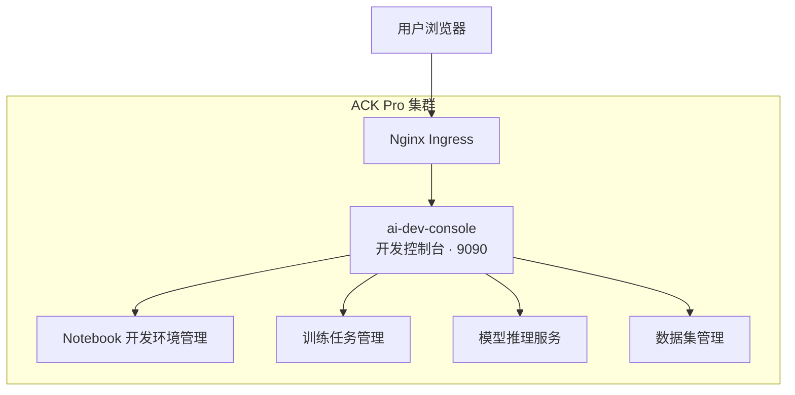
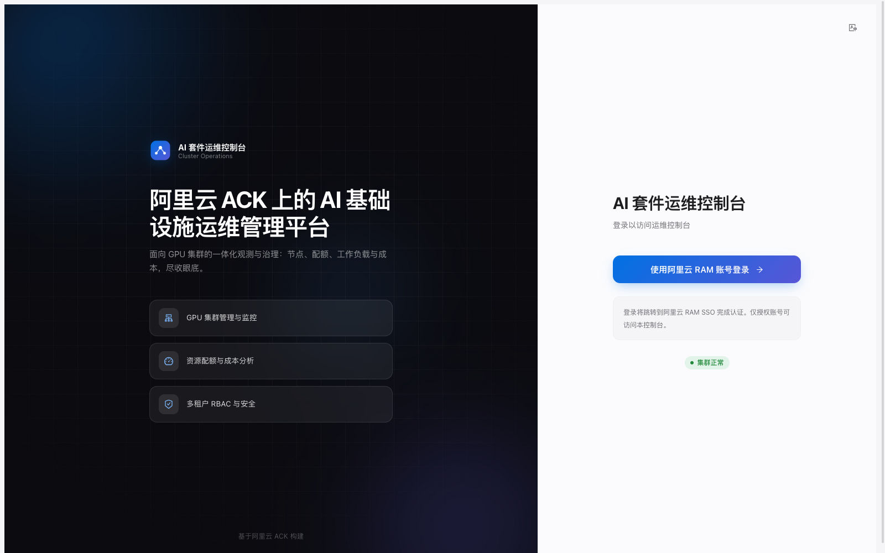
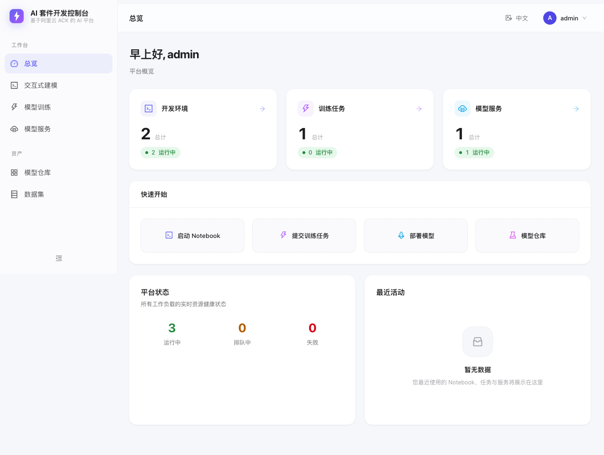

# 部署指南

本文介绍如何在阿里云容器服务 ACK 集群中安装开发控制台（ai-dev-console），并配置身份认证和访问入口。

## 前提条件

| 条件 | 说明 |
|------|------|
| ACK Pro 集群 | Kubernetes 版本不低于 1.20，kubectl 已连接目标集群 |
| Helm 3+ | 本地已安装 Helm CLI |
| Nginx Ingress Controller | 用于暴露控制台；未安装时可使用 ACK 组件或社区 Helm chart |
| 云原生 AI 套件 / ack-arena | 提供训练 operator 和相关 CRD |
| 阿里云账号（仅 `aliyun` 模式） | RAM SSO 模式需要主账号或具有 RAM/IMS 权限的子账号 |
| Notebook Controller（可选） | 仅在需要通过开发控制台管理 Notebook 开发环境时安装 |

## 架构概览



## 认证模式

通过 Helm 参数 `dev-console.auth.mode` 选择认证模式：

| 模式 | 说明 | 是否需要阿里云 AK/SK |
|------|------|---------------------|
| `none`（默认） | 免登录，所有请求以内置 admin 身份运行 | 否 |
| `aliyun` | 阿里云 RAM OAuth2 SSO 登录，主账号自动为 admin | 是 |
| `custom` | 信任上游网关注入的用户身份请求头 | 否 |

`none` 模式适合 PoC、内网环境或已有外层访问控制的场景：

```bash
helm install ack-ai-dev-console charts/ack-ai-dev-console \
  --namespace kube-ai \
  --create-namespace \
  --set dev-console.auth.mode=none \
  ...
```

> **注意**：`none` 模式下任何能够访问控制台地址的人都拥有全部权限，仅限内网、PoC 或已有外层访问控制的环境使用。

`custom` 模式下，控制台信任企业 SSO 或 API Gateway 注入的身份请求头：

| Helm 参数 | 默认值 | 说明 |
|-----------|--------|------|
| `dev-console.auth.custom.userHeader` | `X-Forwarded-User` | 认证后的用户名 |
| `dev-console.auth.custom.groupsHeader` | `X-Forwarded-Groups` | 用户组列表，使用逗号分隔 |
| `dev-console.auth.custom.adminUsers` | 空 | admin 用户名列表 |
| `dev-console.auth.custom.adminGroups` | 空 | admin 用户组列表 |
| `dev-console.auth.custom.loginUrl` | 空 | 未认证浏览器请求的跳转地址 |

上游网关必须剥离客户端伪造的同名请求头。开发控制台会根据 User CR 查询用户角色与 namespace 权限，Notebook、VS Code、TensorBoard 和 Ray Dashboard 的代理流量也会执行身份与权限校验。

`custom` 模式还有以下行为：

- 禁用 Kubernetes Token 登录接口，避免绕过企业身份提供方。
- 每次请求实时读取 User CR 中的角色和 namespace 权限。
- 未认证浏览器请求跳转到 `loginUrl`（如已配置）；API 请求返回 HTTP 401。
- 控制台启动时输出安全提示，提醒管理员剥离客户端伪造的身份请求头。

## 步骤一：配置 RAM 权限（仅 `aliyun` 模式）

`aliyun` 模式需要调用阿里云 IMS API 管理 OAuth 登录应用。创建自定义权限策略，并将其授予集群 Worker Role 或 RRSA 使用的 RAM Role：

```json
{
  "Version": "1",
  "Statement": [
    {
      "Effect": "Allow",
      "Action": [
        "ims:CreateApplication",
        "ims:UpdateApplication",
        "ims:GetApplication",
        "ims:ListApplications",
        "ims:DeleteApplication",
        "ims:CreateAppSecret",
        "ims:GetAppSecret",
        "ims:ListAppSecretIds",
        "ims:ListUsers"
      ],
      "Resource": "*"
    }
  ]
}
```

如果使用 Worker Role，在 RAM 控制台中找到 `KubernetesWorkerRole-<ClusterID>` 并添加该策略；如果使用 RRSA，则将策略授予 ServiceAccount 绑定的 RAM Role。

## 步骤二：准备认证 Secret（仅 `aliyun` 模式）

使用 `aliyun` 模式时，创建 namespace 和访问 IMS API 所需的凭据 Secret：

```bash
kubectl create namespace kube-ai

kubectl create secret generic ai-dev-console-credentials \
  --from-literal=accessKeyId=<YOUR_AK> \
  --from-literal=accessKeySecret=<YOUR_SK> \
  --namespace kube-ai
```

建议同时创建 Session Secret，避免 Pod 重启后所有登录会话失效：

```bash
kubectl create secret generic ai-dev-console-auth \
  --from-literal=sessionSecret=<RANDOM_64_CHAR_HEX> \
  --namespace kube-ai
```

> **安全提示**：请勿将 AK/SK 或 Session Secret 写入代码仓库和 values.yaml。`none` 和 `custom` 模式不需要 IMS API 凭据。

使用 `aliyun` 模式时，在安装命令中追加：

```bash
--set dev-console.auth.mode=aliyun \
--set dev-console.auth.existingSecret=ai-dev-console-auth
```

## 步骤三：安装 Notebook Controller（可选）

Notebook Controller 是开发控制台的可选依赖。只有在需要通过开发控制台完成以下操作时才需要安装：

- 创建 JupyterLab 或 Code Server 开发环境。
- 启动、停止、删除或调整 Notebook 的计算资源。
- 通过开发控制台代理访问 Notebook 开发环境。

如果只使用训练任务、模型推理、数据集等其他功能，可以跳过本步骤，直接安装开发控制台。

需要 Notebook 管理能力时，按照[安装 Notebook Controller](notebook-controller-install.html)完成 Helm 安装，并确认 Notebook CRD 和 controller Deployment 已就绪，再继续下一步。

## 步骤四：安装开发控制台

```bash
helm upgrade --install ack-ai-dev-console charts/ack-ai-dev-console \
  --namespace kube-ai \
  --create-namespace \
  --set 'dev-console.console.ingress.hosts[0].host=<YOUR_CONSOLE_DOMAIN>' \
  --set 'dev-console.console.ingress.hosts[0].paths[0]=/' \
  --wait \
  --timeout 5m
```

主要参数：

| 参数 | 必填 | 说明 |
|------|------|------|
| `dev-console.console.ingress.hosts[0].host` | 是 | Ingress 域名，例如 `ai-dev.example.com` |
| `dev-console.auth.existingSecret` | 否 | Session Secret 名称 |
| `dev-console.auth.mode` | 否 | `none`（默认）、`aliyun` 或 `custom` |
| `dev-console.console.intlAccount` | 否 | 国际站账号设置为 `"true"` |
| `dev-console.console.credentialMode` | 否 | `static` 或 `rrsa` |

## 步骤五：确认安装就绪

```bash
helm status ack-ai-dev-console --namespace kube-ai

kubectl rollout status \
  deployment/ack-ai-dev-console \
  --namespace kube-ai \
  --timeout=2m

kubectl get pods,services,ingresses --namespace kube-ai
```

健康检查应返回 HTTP 200：

```bash
curl -s -o /dev/null -w '%{http_code}\n' \
  http://<YOUR_CONSOLE_DOMAIN>/health
```

## 步骤六：配置域名与 OAuth 回调

获取 Nginx Ingress 的 SLB 地址：

```bash
kubectl get service nginx-ingress-lb \
  --namespace kube-system \
  --output=jsonpath='{.status.loadBalancer.ingress[0].ip}'
```

测试环境可以将 SLB 地址和 `<YOUR_CONSOLE_DOMAIN>` 写入本地 `/etc/hosts`；生产环境建议使用企业 DNS 或阿里云 PrivateZone。

`aliyun` 模式下，控制台启动时会通过 IMS API 创建 RAM OAuth2 Web 应用，回调地址为：

```text
http://<YOUR_CONSOLE_DOMAIN>/api/v1/login/aliyun/callback
```

如需手动管理 OAuth 应用，请参考[创建 RAM OAuth 应用](https://help.aliyun.com/zh/ram/create-an-application)。

配置完成后访问：

```text
http://<YOUR_CONSOLE_DOMAIN>/
```

首次访问会跳转到 RAM SSO 登录页面：



登录后进入开发控制台首页：



## 自行构建镜像（可选）

```bash
cd ai-dev-console
docker build -f Dockerfile.console-new \
  -t <YOUR_REGISTRY>/ai-dev-console:<TAG> .
docker push <YOUR_REGISTRY>/ai-dev-console:<TAG>

helm upgrade ack-ai-dev-console charts/ack-ai-dev-console \
  --namespace kube-ai \
  --set dev-console.image.repository=<YOUR_REGISTRY>/ai-dev-console \
  --set dev-console.image.tag=<TAG> \
  --reuse-values
```

## 离线或跨地域部署 {#offline-deploy}

控制台和 commit-agent 默认镜像来自 `registry-cn-hangzhou.ack.aliyuncs.com/acs/`，开发镜像默认来自 AC2 公共仓库。节点无法直接拉取时：

1. 使用 crane 将 ai-dev-console、commit-agent 和所需 AC2 开发镜像同步到目标地域 ACR。
2. 通过 `dev-console.image.repository` 和 `dev-console.image.commitAgentImageName` 覆盖控制台组件镜像。
3. 使用 `dev-console.imageRewrites` 将 AC2 镜像前缀映射到目标仓库。
4. 如需 Notebook 能力，单独覆盖 Notebook Controller chart 的 `image.repository`。

```bash
helm upgrade ack-ai-dev-console charts/ack-ai-dev-console \
  --namespace kube-ai \
  --reuse-values \
  --set 'dev-console.imageRewrites[0].from=ac2-registry.cn-hangzhou.cr.aliyuncs.com/ac2/' \
  --set 'dev-console.imageRewrites[0].to=registry-vpc.cn-beijing.aliyuncs.com/<NAMESPACE>/'
```

## 常见问题

### Pod 启动时报 `failed to init credential provider`

确认 `ai-dev-console-credentials` Secret 位于 `kube-ai` namespace，并检查当前认证模式和 `credentialMode` 配置。

### OAuth 应用回调地址无效

确认 Ingress host 已设置，并检查 AK 对应 RAM 用户是否具有 IMS 权限。

### 访问域名返回 404

确认 Nginx Ingress Controller 正常运行，并检查开发控制台 Ingress 的 host 和 path：

```bash
kubectl get ingress --namespace kube-ai
kubectl get pods --namespace kube-system | grep nginx-ingress
```

### Notebook 页面可以创建实例但无法打开

确认 Notebook Pod 和同名 Service 已就绪，然后检查开发控制台日志和 Ingress Controller 日志。更多命令参见[运维指南](ops-guide.html#notebook-无法打开)。

## 参考文档

- [创建 ACK Pro 集群](https://help.aliyun.com/zh/ack/ack-managed-and-ack-dedicated/user-guide/create-an-ack-managed-cluster-2)
- [RAM 权限策略管理](https://help.aliyun.com/zh/ram/user-guide/create-a-custom-policy)
- [创建 RAM OAuth 应用](https://help.aliyun.com/zh/ram/create-an-application)
- [Nginx Ingress 概述](https://help.aliyun.com/zh/ack/ack-managed-and-ack-dedicated/user-guide/nginx-ingress-overview)
