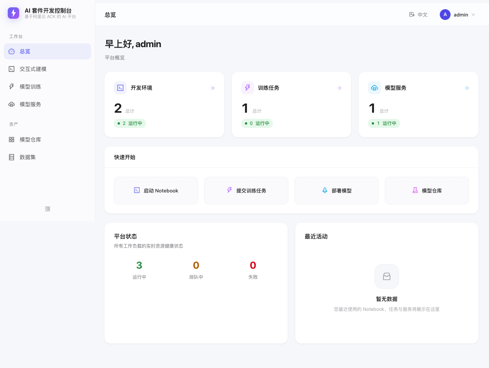
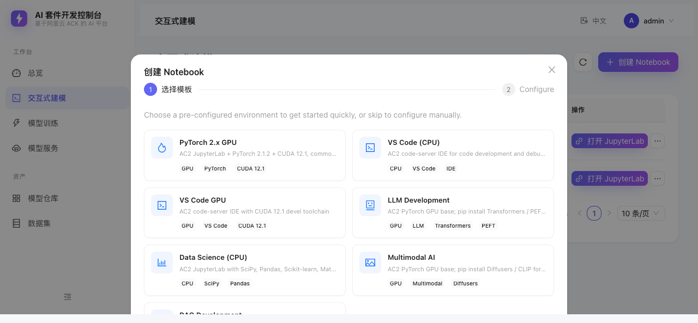
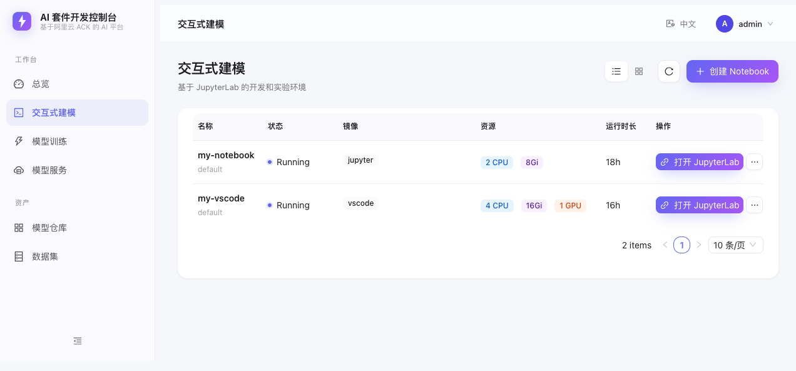
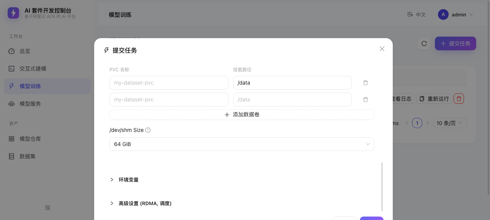
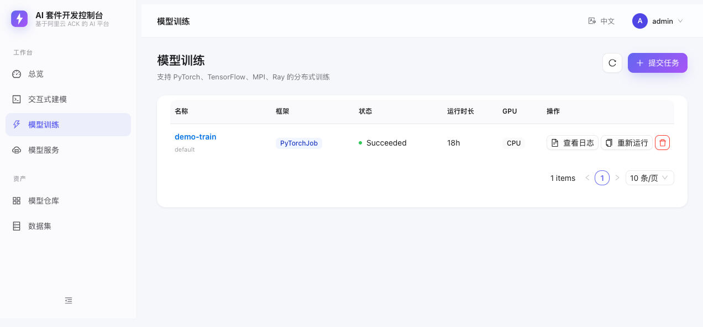
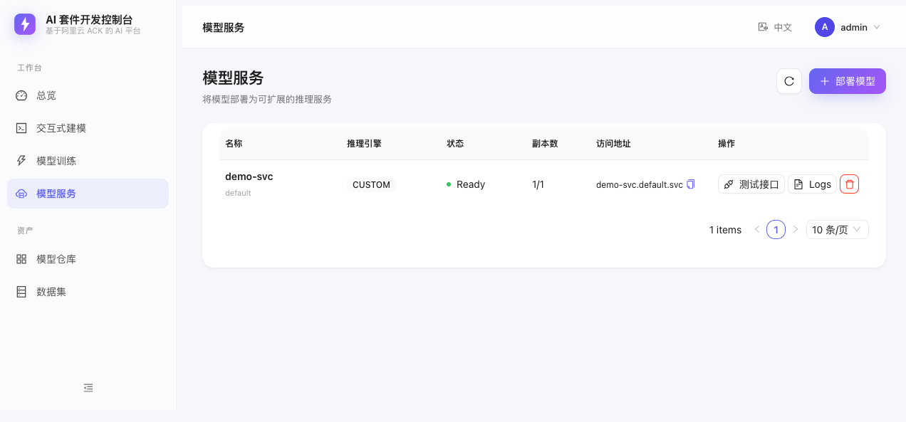
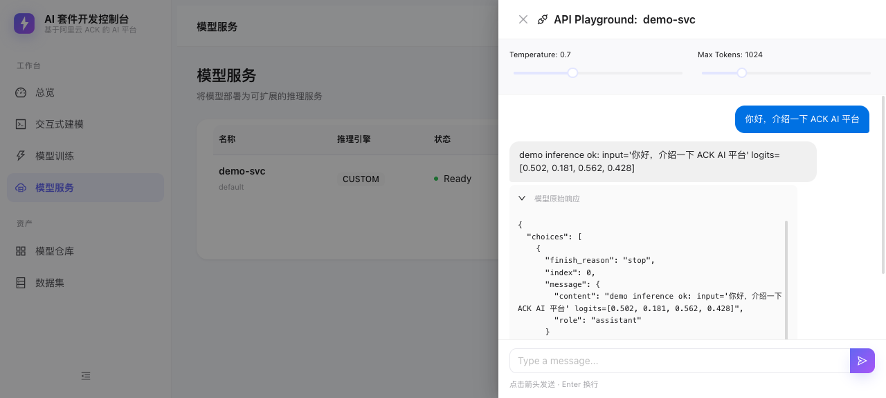
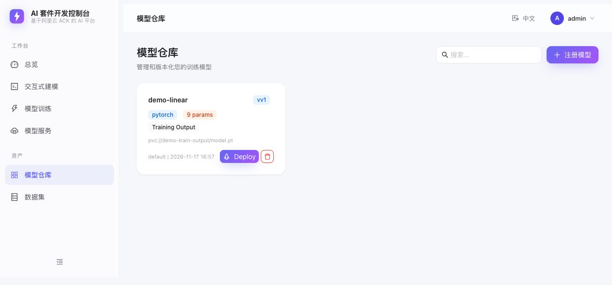
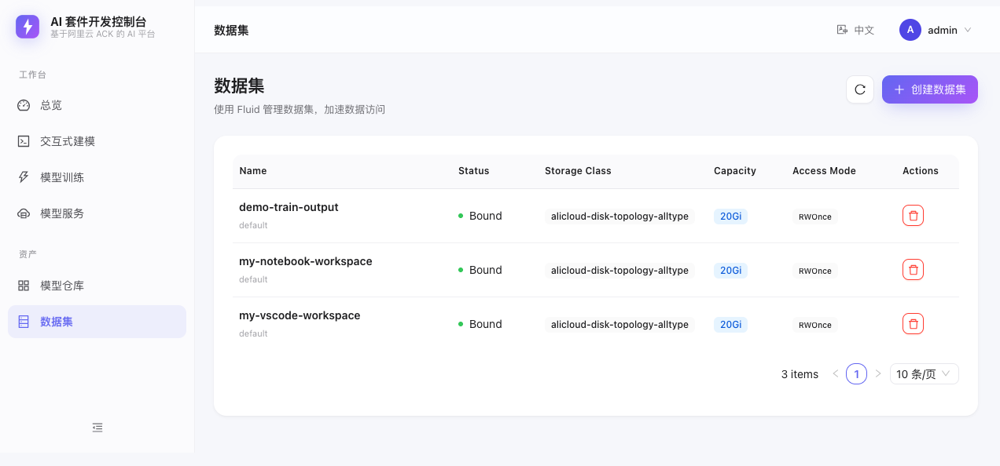

# 功能使用指南

开发控制台面向 ML 工程师和研究员，提供 Notebook、训练任务、模型推理、模型仓库和数据集管理。

## Notebook 管理

### 创建 Notebook

1. 进入 **交互式建模**，点击 **创建 Notebook**。
2. 选择基于 AC2 公共镜像的模板：
   - **PyTorch 2.x GPU**：JupyterLab、PyTorch 和 CUDA。
   - **VS Code (CPU/GPU)**：浏览器内的 code-server IDE。
   - **Data Science (CPU)**：SciPy、Pandas 和 Scikit-learn。
   - **LLM Development / Multimodal AI / RAG Development**：按需安装相应 Python 库的基础镜像。
3. 配置 CPU、内存、GPU、镜像和工作空间存储。
4. 提交后等待 Notebook Pod 进入 Running 状态。

### 访问 Notebook

Notebook 就绪后，点击 **打开 JupyterLab** 或 **打开 VS Code**。代理访问路径为：

- JupyterLab：`https://<domain>/notebook/<namespace>/<name>/lab`
- VS Code：`https://<domain>/vscode/<namespace>/<name>/`

### 生命周期管理

- **停止**：释放计算资源并保留 PVC 数据。
- **启动**：恢复已停止的 Notebook。
- **Resize**：停止后调整 CPU、内存和 GPU。
- **删除**：删除 Notebook，保留 PVC 数据。

列表状态支持悬停查看详情。Starting 状态会展示镜像拉取进度，Failed 状态会展示 CrashLoopBackOff、ImagePullBackOff 等具体原因。

## 训练任务

### 提交训练任务

1. 进入 **模型训练**，点击 **提交任务**。
2. 选择 PyTorchJob、TFJob、MPIJob 或 RayJob。RayJob 需要集群支持 KubeRay。
3. 选择单机或分布式模式，并配置每个节点的 CPU、内存和 GPU。
4. 填写训练镜像与启动命令，或粘贴训练脚本，脚本会挂载为 `/scripts/train.sh`。
5. 添加一个或多个 PVC 数据卷和挂载路径，并设置 `/dev/shm` 大小。
6. 按需配置环境变量、RDMA/IB 预设、调度优先级和配额组。
7. 提交任务。

### 查看任务状态

- 列表展示任务状态、类型和 GPU 数量。
- 详情页展示 Pod 状态、事件、实时日志、Checkpoint、YAML 和 GPU 指标。
- **重新运行**会回填镜像、命令、资源和全部数据挂载。

## 模型推理

### 部署推理服务

1. 进入 **模型服务**，点击 **部署模型**。
2. 选择 vLLM、SGLang、TGI、Triton 或自定义镜像。
3. 配置模型路径、副本数和计算资源。
4. 部署后通过 `<name>.<namespace>.svc` 形式的集群内 Service 访问。

TensorFlow、PyTorch 和 sklearn 框架也可以使用 KServe InferenceService，但需要集群预先安装 KServe。

### API Playground

- 配置 Temperature 和 Max Tokens，输入消息后点击箭头发送，Enter 用于换行。
- 使用 OpenAI 兼容的 `/v1/chat/completions` 协议调用服务。
- 展开 **模型原始响应**可以查看完整 JSON。

## 模型仓库

1. 从训练产物、HuggingFace Hub 或 ModelScope 注册模型。
2. 为模型维护多个版本。
3. 查看模型和训练任务之间的血缘关系。
4. 从已注册模型发起推理服务部署。

## 数据集管理

1. 选择云盘、NAS 或 OSS 对应的 StorageClass。
2. 配置容量和访问模式并创建 PVC 数据集。
3. 在 Notebook 或训练任务中挂载数据集。

## 登录与权限

默认 `none` 模式免登录并以内置 admin 身份运行。使用 `aliyun` 模式时，RAM 主账号获得 admin，子账号通常获得 researcher；researcher 只能操作分配给自己的 namespace。企业用户系统可以使用 `custom` 模式接入。

配置方法参见[部署指南中的认证模式](development-console-deploy-guide.html#认证模式)。

> **安全提示**：`none` 模式下任何能够访问控制台地址的人都拥有全部权限，公网暴露时必须配置入口访问控制。
