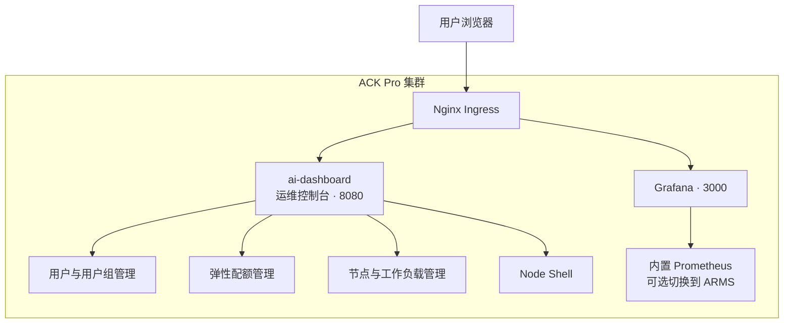
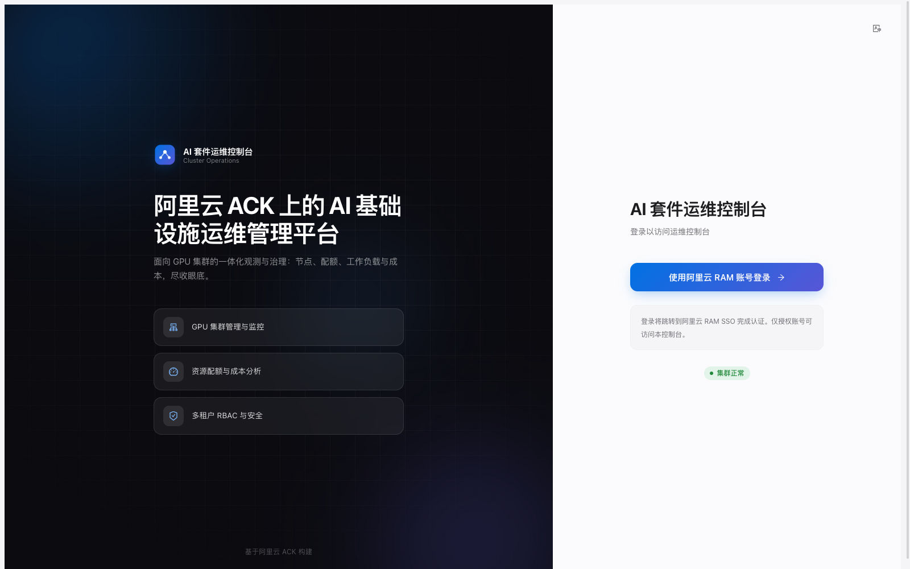
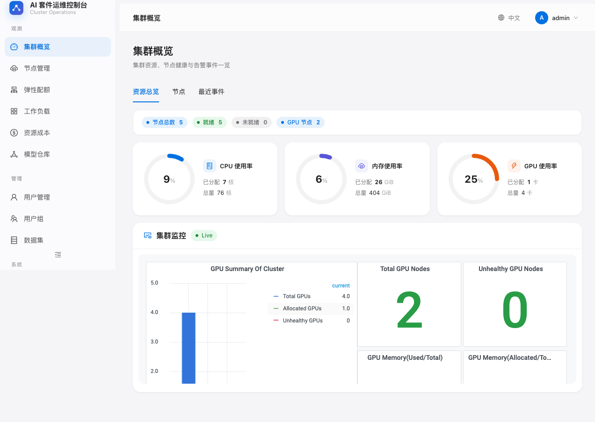

# 部署指南

本文介绍如何在阿里云容器服务 ACK 集群中安装运维控制台（ai-dashboard）及其 Grafana 监控组件。

## 前提条件

| 条件 | 说明 |
|------|------|
| ACK Pro 集群 | Kubernetes 版本不低于 1.20，kubectl 已连接目标集群 |
| Helm 3+ | 本地已安装 Helm CLI |
| Nginx Ingress Controller | 用于暴露控制台；未安装时可使用 ACK 组件或社区 Helm chart |
| 云原生 AI 套件 / ack-arena | 提供训练 operator 与 `arena_*` 监控指标 |
| 阿里云账号（仅 `aliyun` 模式） | RAM SSO 模式需要主账号或具有 RAM/IMS 权限的子账号 |

> **说明**：监控默认使用 chart 内置的 Prometheus，无需预先开通 ARMS。需要托管存储和历史数据时可以切换到 ARMS Prometheus。

## 架构概览



## 认证模式

通过 Helm 参数 `admin-ui.auth.mode` 选择认证模式：

| 模式 | 说明 | 是否需要阿里云 AK/SK |
|------|------|---------------------|
| `none`（默认） | 免登录，所有请求以内置 admin 身份运行 | 否 |
| `aliyun` | 阿里云 RAM OAuth2 SSO 登录，主账号自动为 admin | 是 |
| `custom` | 信任上游网关注入的用户身份请求头 | 否 |

`none` 模式适合 PoC、内网环境或已有外层访问控制的场景：

```bash
helm install ack-ai-dashboard charts/ack-ai-dashboard \
  --namespace kube-ai \
  --create-namespace \
  --set admin-ui.auth.mode=none \
  ...
```

> **注意**：`none` 模式下任何能够访问控制台地址的人都拥有全部权限，仅限内网、PoC 或已有外层访问控制的环境使用。

`custom` 模式下，控制台信任企业 SSO 或 API Gateway 完成认证后注入的请求头：

| Helm 参数 | 默认值 | 说明 |
|-----------|--------|------|
| `admin-ui.auth.custom.userHeader` | `X-Forwarded-User` | 认证后的用户名 |
| `admin-ui.auth.custom.groupsHeader` | `X-Forwarded-Groups` | 用户组列表，使用逗号分隔 |
| `admin-ui.auth.custom.adminUsers` | 空 | admin 用户名列表 |
| `admin-ui.auth.custom.adminGroups` | 空 | admin 用户组列表 |
| `admin-ui.auth.custom.loginUrl` | 空 | 未认证浏览器请求的跳转地址 |

上游网关必须剥离客户端伪造的同名身份请求头，并避免控制台 Service 被绕过网关直接访问。

未认证的浏览器请求会跳转到 `loginUrl`（如已配置）；API 请求返回 HTTP 401，并在响应中携带登录地址。

## 步骤一：配置 RAM 权限（仅 `aliyun` 模式）

`aliyun` 模式需要调用阿里云 IMS API 管理 OAuth 登录应用。创建自定义权限策略，并将其授予集群 Worker Role 或 RRSA 使用的 RAM Role：

```json
{
  "Version": "1",
  "Statement": [
    {
      "Effect": "Allow",
      "Action": [
        "ims:CreateApplication",
        "ims:UpdateApplication",
        "ims:GetApplication",
        "ims:ListApplications",
        "ims:DeleteApplication",
        "ims:CreateAppSecret",
        "ims:GetAppSecret",
        "ims:ListAppSecretIds",
        "ims:ListUsers"
      ],
      "Resource": "*"
    }
  ]
}
```

如果使用 Worker Role，在 RAM 控制台中找到 `KubernetesWorkerRole-<ClusterID>` 并添加该策略；如果使用 RRSA，则将策略授予 ServiceAccount 绑定的 RAM Role。

## 步骤二：准备认证 Secret（仅 `aliyun` 模式）

使用 `aliyun` 模式时，创建 namespace 和访问 IMS API 所需的凭据 Secret：

```bash
kubectl create namespace kube-ai

kubectl create secret generic ai-dashboard-credentials \
  --from-literal=accessKeyId=<YOUR_AK> \
  --from-literal=accessKeySecret=<YOUR_SK> \
  --namespace kube-ai
```

建议同时创建 Session Secret，避免 Pod 重启后所有登录会话失效：

```bash
kubectl create secret generic ai-dashboard-auth \
  --from-literal=sessionSecret=<RANDOM_64_CHAR_HEX> \
  --namespace kube-ai
```

> **安全提示**：请勿将 AK/SK 或 Session Secret 写入代码仓库和 values.yaml。`none` 和 `custom` 模式不需要 IMS API 凭据。

使用 `aliyun` 模式时，在安装命令中追加：

```bash
--set admin-ui.auth.mode=aliyun \
--set admin-ui.auth.existingSecret=ai-dashboard-auth
```

## 步骤三：配置监控

chart 默认部署集群内 Prometheus，并自动接入 Grafana，无需额外配置。

如需使用 ARMS Prometheus，获取其内网 HTTP API 地址：

1. 打开 ACK 控制台中的目标集群。
2. 进入 **运维管理 > Prometheus 监控**。
3. 点击 **设置**，复制 HTTP API 内网地址。

地址格式如下：

```text
http://cn-<region>-intranet.arms.aliyuncs.com:9090/api/v1/prometheus/<实例ID>/<UID>/<集群ID>/<region>
```

安装时关闭内置 Prometheus，并设置 Grafana 数据源：

```bash
--set prometheus.enabled=false \
--set 'grafana.datasources.datasources\.yaml.datasources[0].url=<PROMETHEUS_URL>'
```

## 步骤四：安装运维控制台

```bash
helm upgrade --install ack-ai-dashboard charts/ack-ai-dashboard \
  --namespace kube-ai \
  --create-namespace \
  --set 'admin-ui.dashboard.ingress.hosts[0].host=<YOUR_DASHBOARD_DOMAIN>' \
  --set 'admin-ui.dashboard.ingress.hosts[0].paths[0]=/' \
  --set grafana.adminPassword=<YOUR_GRAFANA_PASSWORD> \
  --wait \
  --timeout 5m
```

> **release 名说明**：建议使用 `ack-ai-dashboard`，使默认 Grafana 反向代理目标 `ack-ai-dashboard-grafana.kube-ai:80` 正确解析。使用其他 release 名时，需要同步设置 `admin-ui.dashboard.grafanaProxyTarget`。

主要参数：

| 参数 | 必填 | 说明 |
|------|------|------|
| `admin-ui.dashboard.ingress.hosts[0].host` | 是 | Ingress 域名，例如 `ai-dashboard.example.com` |
| `grafana.adminPassword` | 是 | Grafana 管理员密码 |
| `admin-ui.auth.existingSecret` | 否 | Session Secret 名称 |
| `admin-ui.auth.mode` | 否 | `none`（默认）、`aliyun` 或 `custom` |
| `prometheus.enabled` | 否 | 是否部署内置 Prometheus，默认 `true` |
| `admin-ui.dashboard.intlAccount` | 否 | 国际站账号设置为 `"true"` |
| `admin-ui.dashboard.credentialMode` | 否 | `static` 或 `rrsa` |

## 步骤五：确认安装就绪

```bash
helm status ack-ai-dashboard --namespace kube-ai

kubectl rollout status \
  deployment/ack-ai-dashboard-admin-ui \
  --namespace kube-ai \
  --timeout=2m

kubectl get pods,services,ingresses --namespace kube-ai
```

健康检查应返回 HTTP 200：

```bash
curl -s -o /dev/null -w '%{http_code}\n' \
  http://<YOUR_DASHBOARD_DOMAIN>/health
```

## 步骤六：配置域名与 OAuth 回调

获取 Nginx Ingress 的 SLB 地址：

```bash
kubectl get service nginx-ingress-lb \
  --namespace kube-system \
  --output=jsonpath='{.status.loadBalancer.ingress[0].ip}'
```

测试环境可以将 SLB 地址和 `<YOUR_DASHBOARD_DOMAIN>` 写入本地 `/etc/hosts`；生产环境建议使用企业 DNS 或阿里云 PrivateZone。

`aliyun` 模式下，控制台启动时会通过 IMS API 创建 RAM OAuth2 Web 应用，回调地址为：

```text
http://<YOUR_DASHBOARD_DOMAIN>/login/aliyun
```

如需手动管理 OAuth 应用，请参考[创建 RAM OAuth 应用](https://help.aliyun.com/zh/ram/create-an-application)。

配置完成后访问：

```text
http://<YOUR_DASHBOARD_DOMAIN>/
```

首次访问会跳转到 RAM SSO 登录页面：



登录后进入运维控制台首页：



## 自行构建镜像（可选）

```bash
cd ai-dashboard
docker build -t <YOUR_REGISTRY>/ai-dashboard:<TAG> .
docker push <YOUR_REGISTRY>/ai-dashboard:<TAG>

helm upgrade ack-ai-dashboard charts/ack-ai-dashboard \
  --namespace kube-ai \
  --set admin-ui.image.repository=<YOUR_REGISTRY>/ai-dashboard \
  --set admin-ui.image.tag=<TAG> \
  --reuse-values
```

## 离线或跨地域部署 {#offline-deploy}

默认镜像来自 `registry-cn-hangzhou.ack.aliyuncs.com/acs/`。节点无法直接拉取时，先使用 crane 将 ai-dashboard、Grafana、Prometheus 等镜像同步到目标地域的 ACR，再通过 `admin-ui.image.repository`、`grafana.image.repository` 和 `prometheus.image.repository` 覆盖仓库地址。

```bash
crane copy registry-cn-hangzhou.ack.aliyuncs.com/acs/ai-dashboard:v3.3.0 \
  registry-vpc.cn-beijing.aliyuncs.com/<NAMESPACE>/ai-dashboard:v3.3.0
```

## 常见问题

### Pod 启动时报 `failed to init credential provider`

确认 `ai-dashboard-credentials` Secret 位于 `kube-ai` namespace，并检查当前认证模式和 `credentialMode` 配置。

### OAuth 应用回调地址无效

确认 Ingress host 已设置，并检查 AK 对应 RAM 用户是否具有 IMS 权限。

### 访问域名返回 404

确认 Nginx Ingress Controller 正常运行，并检查运维控制台 Ingress 的 host 和 path：

```bash
kubectl get ingress --namespace kube-ai
kubectl get pods --namespace kube-system | grep nginx-ingress
```

### Grafana 面板没有数据

默认模式下检查 `prometheus-server` Pod 和 Grafana 数据源；使用 ARMS 时确认 URL 为内网 HTTP API 地址。

## 参考文档

- [创建 ACK Pro 集群](https://help.aliyun.com/zh/ack/ack-managed-and-ack-dedicated/user-guide/create-an-ack-managed-cluster-2)
- [RAM 权限策略管理](https://help.aliyun.com/zh/ram/user-guide/create-a-custom-policy)
- [ACK Prometheus 监控](https://help.aliyun.com/zh/ack/ack-managed-and-ack-dedicated/user-guide/use-managed-service-for-prometheus-to-monitor-an-ack-cluster)
- [Nginx Ingress 概述](https://help.aliyun.com/zh/ack/ack-managed-and-ack-dedicated/user-guide/nginx-ingress-overview)
