# 功能使用指南

运维控制台面向集群管理员，提供集群监控、节点运维、用户与配额管理、工作负载和成本视图。

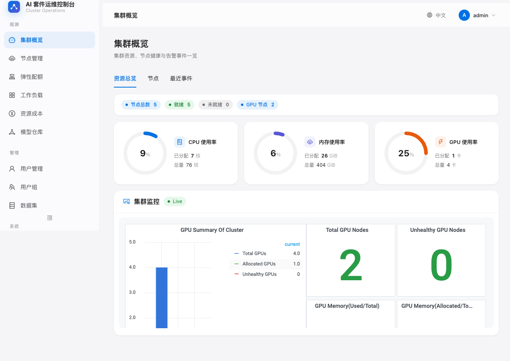

## 集群概览与监控

首页的集群概览展示：

- CPU、内存、GPU 的总量与已分配资源，以及节点总数、就绪数和 GPU 节点数。
- 节点状态和最近的集群 Warning 事件。
- 内嵌 Grafana 面板，包括 GPU 汇总、显存使用和训练任务汇总等。

监控数据默认来自 chart 内置的 Prometheus，采集 `arena-exporter` 与 GPU exporter，无需开通 ARMS。需要使用托管 Prometheus 时，参见[部署指南中的监控配置](operations-console-deploy-guide.html#监控配置)。

## 用户管理

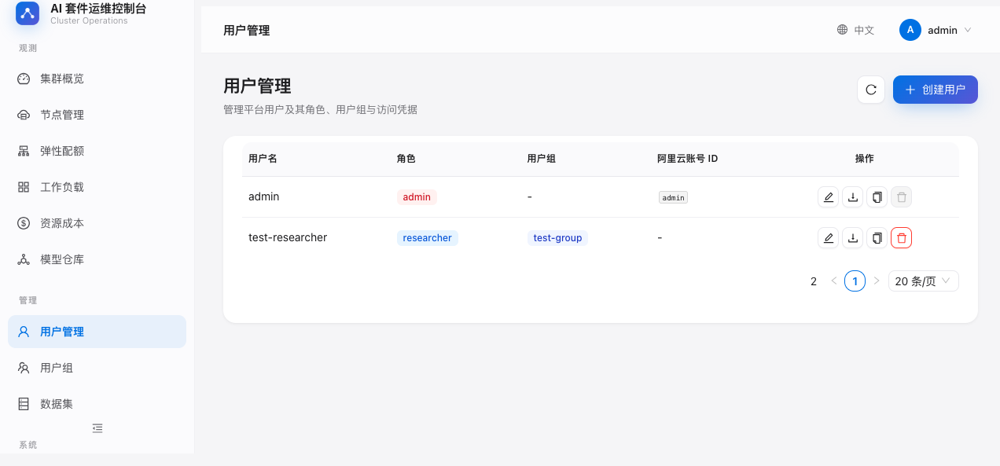

1. 进入 **用户管理**，点击 **创建用户**。
2. 填写用户名并选择 `admin` 或 `researcher` 角色。
3. 为用户绑定命名空间角色，限定其可以操作的 namespace。
4. 创建后可以下载该用户的 kubeconfig 或 Bearer Token，用于命令行访问集群。

`none` 模式下管理的是平台本地用户（User CRD）；`aliyun` 模式下可以关联 RAM 子账号。researcher 越权访问未分配的 namespace 时返回 HTTP 403。

## 用户组与弹性配额

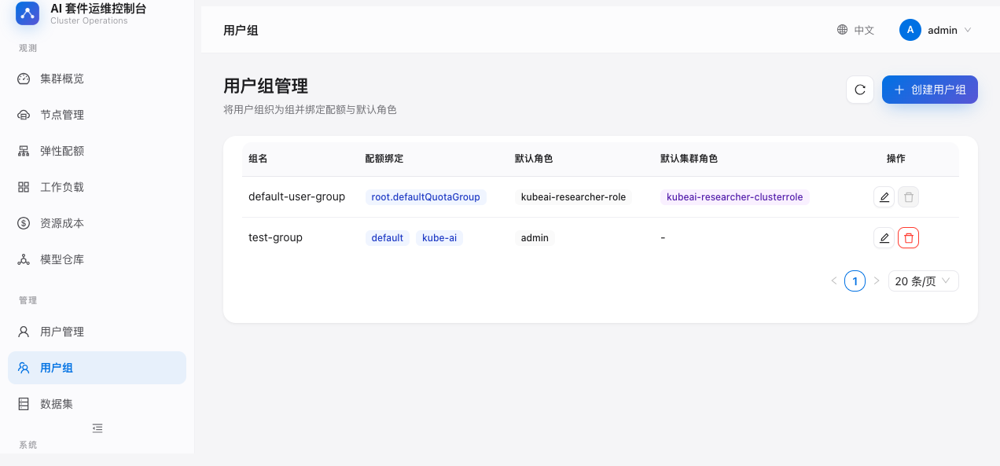

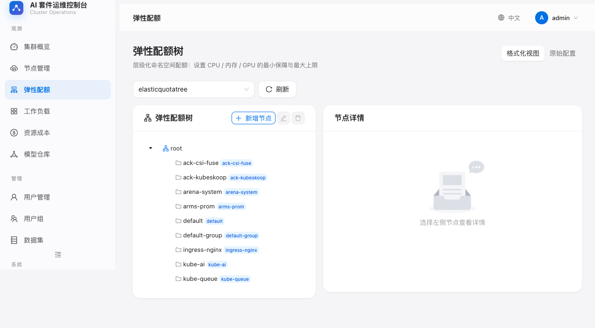

- **用户组**：将用户组织为组，并绑定配额节点和默认角色。
- **弹性配额**：管理 ElasticQuotaTree。首次使用时点击 **初始化默认配额树**，随后可以新增节点、编辑 CPU、内存、GPU 的 min/max 并绑定 namespace。

配额由 ACK 弹性配额调度器执行。

## 节点管理与 Node Shell

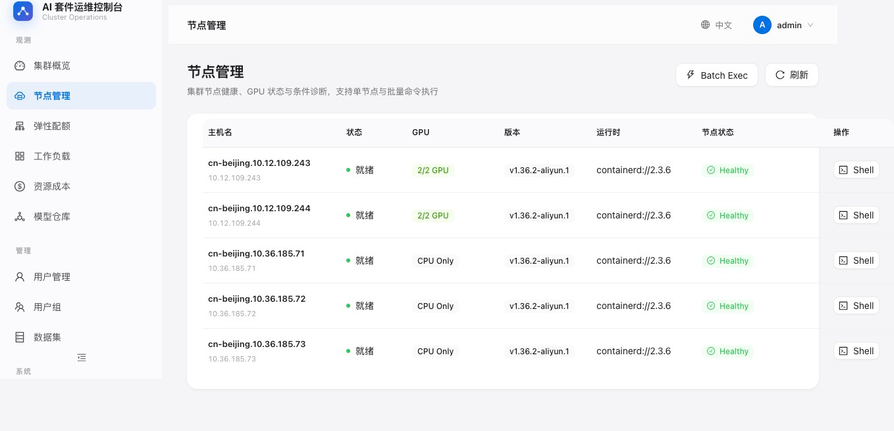

节点页面展示节点状态、GPU 资源分布、运行时版本和健康诊断。

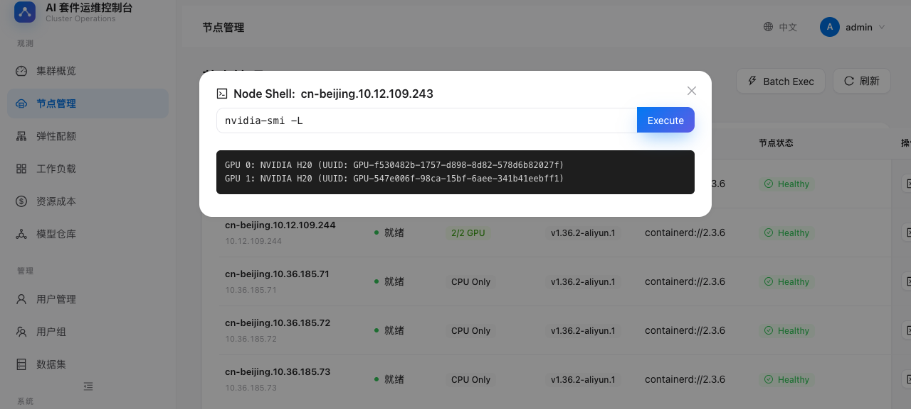

点击节点的 **Shell** 按钮可以执行 `nvidia-smi -L`、`df -h`、`free -m` 等命令；Batch Exec 支持在最多 20 个节点上批量执行。

> **安全说明**：Node Shell 只允许 admin 角色使用，普通用户调用返回 HTTP 403。

## 工作负载

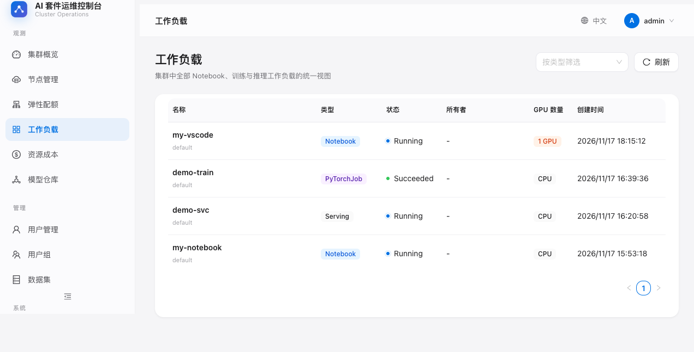

统一查看 Notebook、PyTorchJob、TFJob、MPIJob、RayJob 和推理服务，页面展示类型、状态、GPU 数量与创建时间，并支持按类型筛选。

## 资源成本

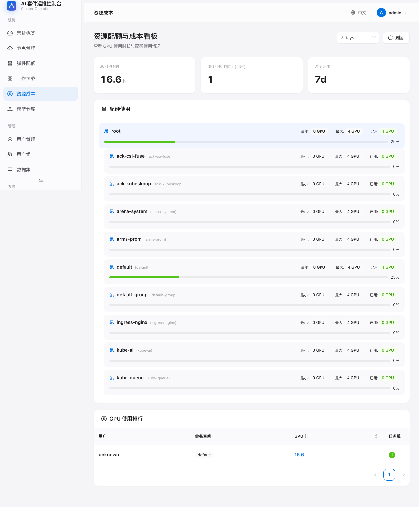

按用户或团队统计 GPU 使用时长和任务数，并结合配额树展示资源占用，用于成本分摊和容量规划。

## 模型仓库

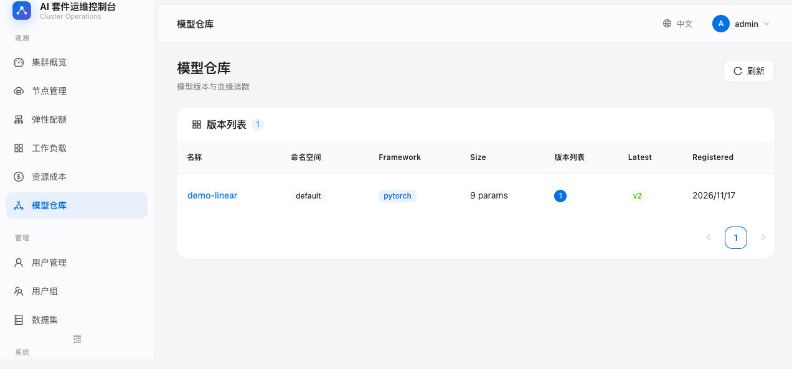

查看平台注册的全部模型、版本和血缘关系，统一管理模型资产。

## 数据集

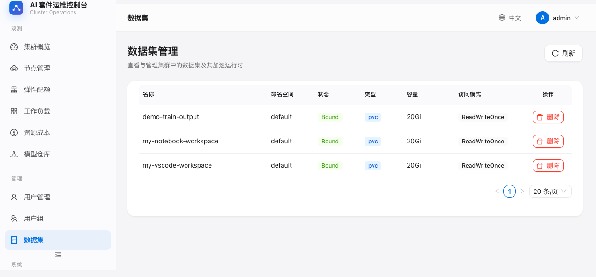

查看集群中的 PVC 数据集及其状态、容量、StorageClass 和访问模式。

## 平台设置

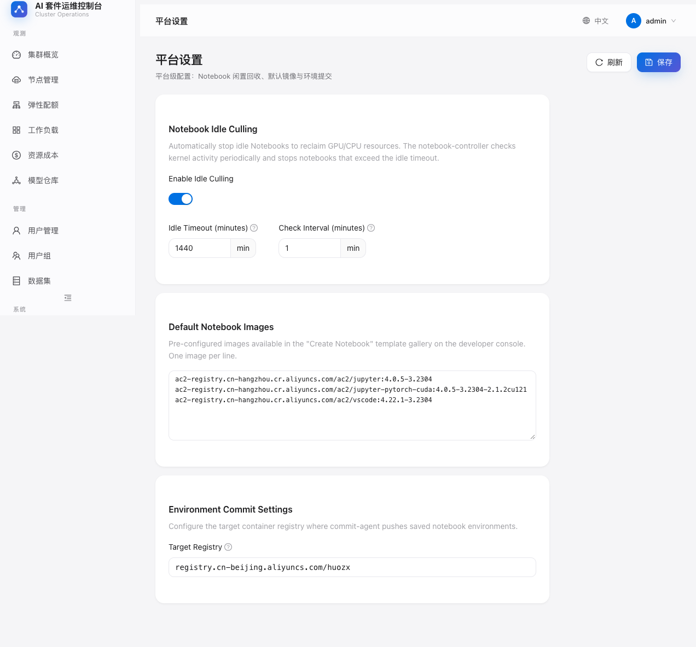

- **默认开发镜像**：配置 Notebook 和训练表单预填的镜像列表，默认使用 AC2 公共镜像。
- **Notebook 闲置回收**：配置是否启用 culling、闲置时长和检查周期。
- **镜像提交仓库**：配置 Notebook 环境提交镜像时使用的目标仓库。

## 登录与权限

默认 `none` 模式免登录并以内置 admin 身份运行。控制台还支持阿里云 RAM SSO 和企业网关注入身份，配置方法参见[部署指南中的认证模式](operations-console-deploy-guide.html#认证模式)。

admin 可以操作所有 namespace，并使用 Node Shell、用户管理、配额管理和平台设置功能。

> **安全提示**：`none` 模式下任何能够访问控制台地址的人都拥有全部权限，公网暴露时必须配置入口访问控制。
