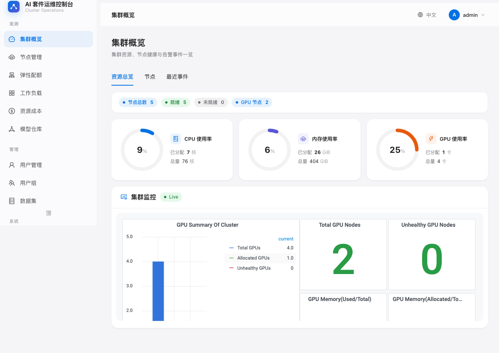
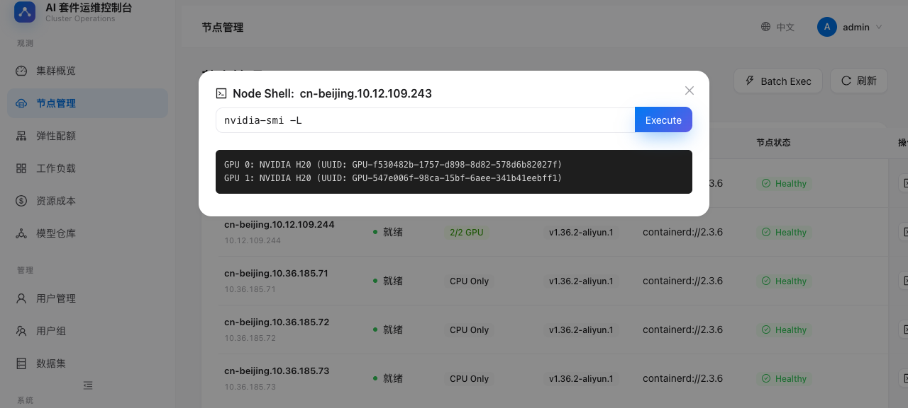

# 运维指南

本文介绍 data-on-ack AI 平台的日常运维操作：组件清单、升级、扩缩容、监控运维、故障排查、安全加固与卸载。

> 本文 Helm 命令统一使用 release 名 `ack-ai-dashboard` 与 `ack-ai-dev-console`、命名空间 `kube-ai`（与[部署指南](deploy-guide)一致）。

## 组件清单

| 组件 | 工作负载 | 端口 | 健康检查 |
|------|----------|------|----------|
| 运维控制台 | `ack-ai-dashboard-admin-ui` (Deployment) | 8080 | `/health` |
| 开发控制台 | `ack-ai-dev-console` (Deployment) | 9090 | `/health` |
| Grafana | `ack-ai-dashboard-grafana` (Deployment) | 3000 | `/api/health` |
| 集群内 Prometheus | `prometheus-server` (Deployment) | 9090 | `/-/ready` |
| Notebook Controller | `notebook-controller-deployment` (Deployment) | 8443 | `/healthz` |
| Commit Agent | `ack-commit-agent` (DaemonSet) | 9090 | `ack-commit-ctl version` |
| 默认 SC 保障 | `kubeai-ensure-default-sc` (Helm hook Job) | — | 一次性执行 |

```bash
kubectl get pods -n kube-ai
```

## 升级

### Helm 升级

```bash
# 升级运维控制台
helm upgrade ack-ai-dashboard charts/ack-ai-dashboard -n kube-ai \
  --set admin-ui.image.tag=<NEW_TAG> --reuse-values

# 升级开发控制台（含 commit-agent / notebook-controller 镜像）
helm upgrade ack-ai-dev-console charts/ack-ai-dev-console -n kube-ai \
  --set dev-console.image.tag=<NEW_TAG> --reuse-values
```

> **`--reuse-values` vs `--reset-values`**：`--reuse-values` 保留上次安装的全部自定义值；`--reset-values` 回到 chart 默认值再叠加本次 `--set`。升级 chart 版本并希望采用新默认值时用 `--reset-values`（注意重新提供 `grafana.adminPassword` 等必填项）。
>
> 集群已安装云原生 AI 套件时，CRD 可能已被 `ack-kdm` 管理，Helm 4 需加 `--force-conflicts` 接管（schema 一致时安全）。

### 自行构建新版本

```bash
git pull origin main
cd ai-dashboard && docker build -t <registry>/ai-dashboard:<tag> .
cd ai-dev-console && docker build -f Dockerfile.console-new -t <registry>/ai-dev-console:<tag> .
docker push <registry>/ai-dashboard:<tag>
docker push <registry>/ai-dev-console:<tag>
helm upgrade ack-ai-dashboard charts/ack-ai-dashboard -n kube-ai \
  --set admin-ui.image.repository=<registry>/ai-dashboard \
  --set admin-ui.image.tag=<tag> --reuse-values
```

> 建议使用最新 Go 工具链（>= 1.27.4）、静态编译（`CGO_ENABLED=0`）与精简基础镜像，消除 OS/stdlib 层 CVE。

## 扩缩容

```bash
kubectl scale deploy ack-ai-dashboard-admin-ui -n kube-ai --replicas=2
kubectl scale deploy ack-ai-dev-console -n kube-ai --replicas=2
```

> **注意**：多副本时必须配置 `auth.existingSecret`（共享 Session Secret），否则各 Pod 生成随机 Session Key 导致登录状态不一致。`none` 模式无会话状态，可直接多副本。

## 日志查看

```bash
kubectl logs -f deploy/ack-ai-dashboard-admin-ui -n kube-ai      # 运维控制台
kubectl logs -f deploy/ack-ai-dev-console -n kube-ai             # 开发控制台
kubectl logs -f deploy/notebook-controller-deployment -n kube-ai # Notebook Controller
kubectl logs -f deploy/prometheus-server -n kube-ai              # 内置 Prometheus
kubectl logs -f ds/ack-commit-agent -n kube-ai                   # Commit Agent
```

## 监控运维



默认由 chart 内置 Prometheus 采集 `arena-exporter`（`arena_*`）与 GPU exporter（`nvidia_gpu_*`），Grafana 经运维控制台 `/grafana/` 路径访问。默认面板：

| 面板 | 内容 |
|------|------|
| Cluster Details | 集群资源总览、GPU 汇总 |
| Node Details | 单节点资源利用率 |
| Resource Quota | 弹性配额使用 |
| Training Jobs | 训练任务资源消耗 |

**检查采集链路：**

```bash
kubectl get pods -n kube-ai -l app=prometheus-server
# 查询指标是否就绪
kubectl -n kube-ai exec deploy/prometheus-server -- \
  wget -qO- 'http://localhost:9090/api/v1/query?query=arena_total_gpus_of_cluster'
```

**切换到 ARMS Prometheus**：见[部署指南 · 监控配置](deploy-guide.md#monitoring)（`prometheus.enabled=false` + Grafana 数据源 url）。

## 故障排查

### Pod CrashLoopBackOff

```bash
kubectl logs <pod-name> -n kube-ai --previous
```

| 错误信息 | 原因 | 解决方案 |
|----------|------|----------|
| `failed to init credential provider` | **仅 aliyun 模式**：AK/SK Secret 缺失 | 创建 `ai-dashboard-credentials` / `ai-dev-console-credentials`；none 模式不应出现 |
| `IMS UpdateApplication: InvalidParameter` | OAuth redirect URI 为空 | 检查 Ingress host 配置 |
| `failed to init k8s client` | ServiceAccount 无权限 | 检查 RBAC Role/ClusterRole |
| `get secret kube-ai/admin-token` | none 模式 admin 身份未就绪 | 确认 dev-console chart 的 admin-user 资源已创建 |

### Ingress 访问异常

```bash
kubectl get ingress -n kube-ai
kubectl get pods -n ingress-nginx        # 社区 chart
kubectl get pods -n kube-system | grep nginx-ingress   # ACK 组件
```

确认域名解析到正确的 SLB IP，Ingress host 与访问域名一致。

### Notebook 无法打开 / 一直 Pending

```bash
kubectl get pods -n <ns> | grep <notebook-name>
kubectl describe pod <notebook-name>-0 -n <ns>
kubectl logs deploy/notebook-controller-deployment -n kube-ai | grep <notebook-name>
```

- **Pending（PVC 未绑定）**：工作空间 PVC 需要默认 StorageClass。chart hook 会在无默认 SC 时自动标记 `alicloud-disk-topology-alltype`；若集群无该 SC，手动设置：`kubectl annotate sc <name> storageclass.kubernetes.io/is-default-class=true`。
- **ImagePullBackOff**：节点无法拉取镜像，见[镜像与离线运维](#image-ops)。
- **CrashLoopBackOff（VS Code）**：确认 Notebook 使用了正确的 code-server 启动命令（chart 模板已内置）。

### OAuth 登录失败（仅 aliyun 模式）

`none` / `custom` 模式不涉及 RAM OAuth，排查请直接看控制台 Pod 日志的 `auth mode` 启动行。aliyun 模式：

1. 确认 RAM 权限策略已授权 IMS 相关 Action；
2. 确认 AK/SK 有效未过期；
3. 查看控制台日志中的 IMS 报错；
4. 确认 Ingress 域名正确解析到 SLB IP。

## 镜像与离线运维 {#image-ops}

默认镜像仓库 `registry-cn-hangzhou.ack.aliyuncs.com/acs/`，开发镜像默认 AC2 公共镜像。无公网出口/跨地域集群：

1. 用 crane 将镜像同步到可达 ACR（见[部署指南 · 离线部署](deploy-guide.md#offline-deploy)）；
2. 覆盖控制台镜像仓库（`admin-ui.image.repository`、`dev-console.image.repository`、`notebook.image.repository`、`dev-console.image.commitAgentImageName`、`grafana.image.repository`、`prometheus.image.repository`）；
3. 配置 AC2 开发镜像前缀映射：

```bash
helm upgrade ack-ai-dev-console charts/ack-ai-dev-console -n kube-ai --reuse-values \
  --set 'dev-console.imageRewrites[0].from=ac2-registry.cn-hangzhou.cr.aliyuncs.com/ac2/' \
  --set 'dev-console.imageRewrites[0].to=registry-vpc.cn-beijing.aliyuncs.com/<ns>/'
```

映射规则经 `/api/v1/config/images` 下发，运行时重写内置开发镜像地址。

## Session 管理

```bash
# 启用持久化 Session
kubectl create secret generic ai-dashboard-auth -n kube-ai \
  --from-literal=sessionSecret=$(openssl rand -hex 32)
helm upgrade ack-ai-dashboard charts/ack-ai-dashboard -n kube-ai \
  --set admin-ui.auth.existingSecret=ai-dashboard-auth --reuse-values

# 轮换 Session Secret（所有用户需重新登录）
kubectl create secret generic ai-dashboard-auth -n kube-ai \
  --from-literal=sessionSecret=$(openssl rand -hex 32) --dry-run=client -o yaml | kubectl apply -f -
kubectl rollout restart deploy/ack-ai-dashboard-admin-ui -n kube-ai
```

## 安全加固

### 启用 HTTPS

```bash
kubectl create secret tls ai-dashboard-tls --cert=tls.crt --key=tls.key -n kube-ai
helm upgrade ack-ai-dashboard charts/ack-ai-dashboard -n kube-ai --reuse-values \
  --set 'admin-ui.dashboard.ingress.tls[0].secretName=ai-dashboard-tls' \
  --set 'admin-ui.dashboard.ingress.tls[0].hosts[0]=<domain>' \
  --set admin-ui.auth.secureCookie=true
```

### 轮换 AK/SK（aliyun 模式）

```bash
kubectl create secret generic ai-dashboard-credentials -n kube-ai \
  --from-literal=accessKeyId=<NEW_AK> --from-literal=accessKeySecret=<NEW_SK> \
  --dry-run=client -o yaml | kubectl apply -f -
kubectl rollout restart deploy/ack-ai-dashboard-admin-ui -n kube-ai
```

### 访问控制

`none` 模式公网暴露时，务必为 SLB 配置 ACL 白名单或改用内网 SLB；生产建议切换 `aliyun` / `custom` 认证模式。



> Node Shell / Batch Exec 仅限 admin，操作节点命令请遵循最小权限与审计要求。

## 备份与恢复

平台状态主要存于 CRD 与少量 ConfigMap/Secret，备份重点：

```bash
# 用户 / 用户组 / 配额树
kubectl get users,usergroups -n kube-ai -o yaml > ai-users-backup.yaml
kubectl get elasticquotatrees -n kube-system -o yaml > ai-quota-backup.yaml
# 平台设置与凭据
kubectl get cm kubeai-platform-config -n kube-ai -o yaml > ai-config-backup.yaml
```

Notebook/训练/推理工作负载及其 PVC 数据按命名空间常规备份（Velero 等）。恢复时 `kubectl apply -f` 上述清单即可重建平台配置。

## 卸载

```bash
helm uninstall ack-ai-dev-console -n kube-ai
helm uninstall ack-ai-dashboard -n kube-ai

# 清理 Secret（可选）
kubectl delete secret ai-dashboard-credentials ai-dev-console-credentials \
  ai-dashboard-auth ai-dev-console-auth -n kube-ai
```

> **CRD 清理需谨慎**：`notebooks.kubeflow.org`、`users.data.kubeai.alibabacloud.com`、`usergroups.data.kubeai.alibabacloud.com` 删除会清除所有对应资源。`elasticquotatrees.scheduling.sigs.k8s.io` 可能由云原生 AI 套件（ack-arena）共用，**卸载控制台时不要删除**，以免影响调度器。Helm 默认不删除 CRD，如需清理请手动评估后执行。
