# 功能使用指南

本文介绍 data-on-ack AI 平台的核心功能和使用方法。平台包含两个控制台：

- **运维控制台（ai-dashboard）**：面向集群管理员，提供集群监控、节点运维、用户/配额管理、工作负载与成本视图。
- **开发控制台（ai-dev-console）**：面向 ML 工程师/研究员，提供 Notebook、训练任务、模型推理、模型仓库与数据集管理。

部署方法见[部署指南](deploy-guide)。默认认证模式为 `none`（免登录，内置 admin），下文截图均取自该模式下的实测环境。

## 运维控制台（ai-dashboard）

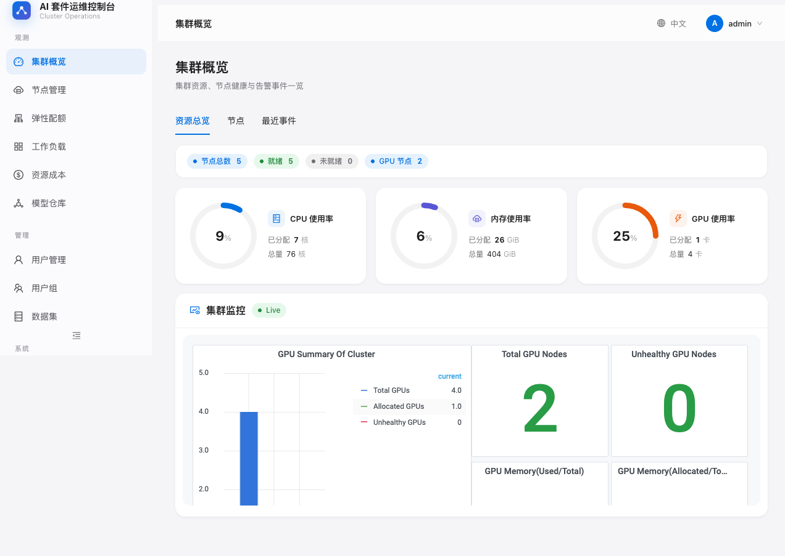

### 集群概览与监控

首页「集群概览」展示：

- **资源总览**：CPU / 内存 / GPU 的总量与已分配（环形图），节点总数、就绪数、GPU 节点数；
- **节点 / 最近事件** 标签页：节点状态与集群 Warning 事件；
- **集群监控**：内嵌 Grafana 面板（GPU 汇总、显存使用、训练任务汇总等），数据来自 chart 内置的集群内 Prometheus（采集 `arena-exporter` 与 GPU exporter），**开箱即有数据**，无需开通 ARMS。如需对接 ARMS，见[部署指南 · 监控配置](deploy-guide.md#monitoring)。

### 用户管理

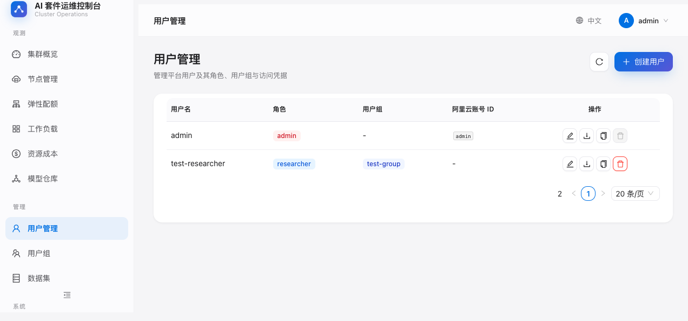

管理平台用户及其角色、命名空间权限与访问凭据：

1. 进入 **用户管理**，点击 **创建用户**；
2. 填写用户名，选择角色（`admin` / `researcher`）；
3. 为用户绑定命名空间角色（决定可操作的 namespace）；
4. 创建后可下载该用户的 **kubeconfig** 或 **Bearer Token**，用于命令行访问集群。

> `none` 模式下用户为平台本地用户（User CRD）；`aliyun` 模式下可关联 RAM 子账号。researcher 的权限严格限制在所分配的命名空间内（越权访问返回 403）。

### 用户组与弹性配额

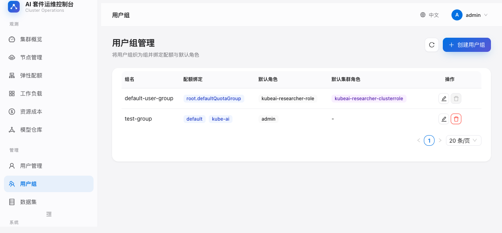

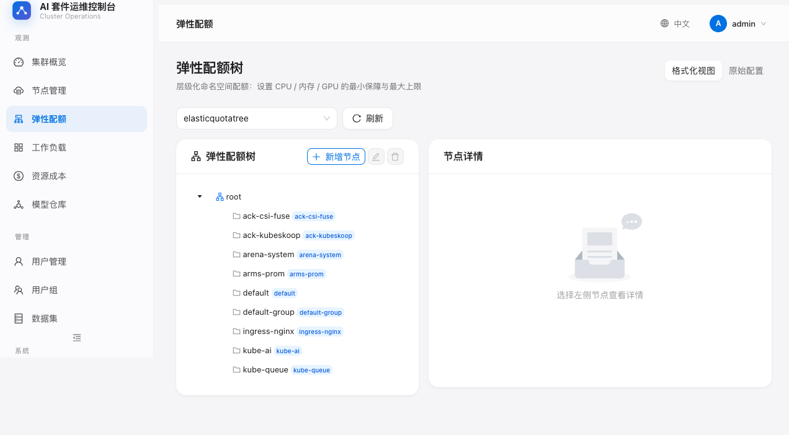

- **用户组**：将用户组织为组，绑定配额节点与默认角色；
- **弹性配额**：管理 `ElasticQuotaTree`。首次使用点击 **初始化默认配额树**（根节点为集群容量，每个命名空间一个子节点），随后可 **新增节点**、编辑节点的 min/max（CPU/内存/GPU）与绑定命名空间。配额由 ACK 弹性配额调度器真实执行。

### 节点管理与 Node Shell

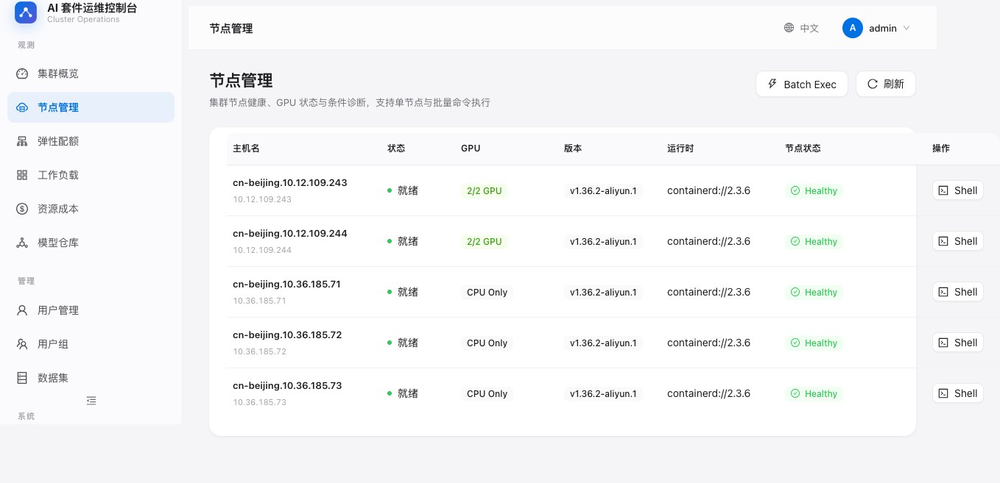

查看集群节点状态、GPU 资源分布、运行时版本与健康诊断。

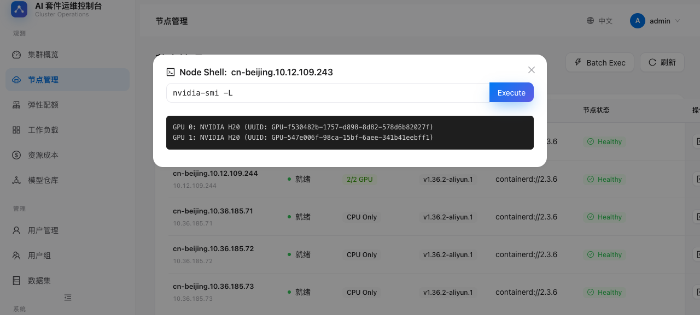

点击节点的 **Shell** 按钮可在节点上执行命令（如 `nvidia-smi -L`、`df -h`、`free -m`），用于检查 GPU 驱动、排查网络与磁盘问题；**Batch Exec** 支持最多 20 个节点批量执行。

> **安全说明**：Node Shell 仅限 admin 角色使用，普通用户调用返回 403。

### 工作负载

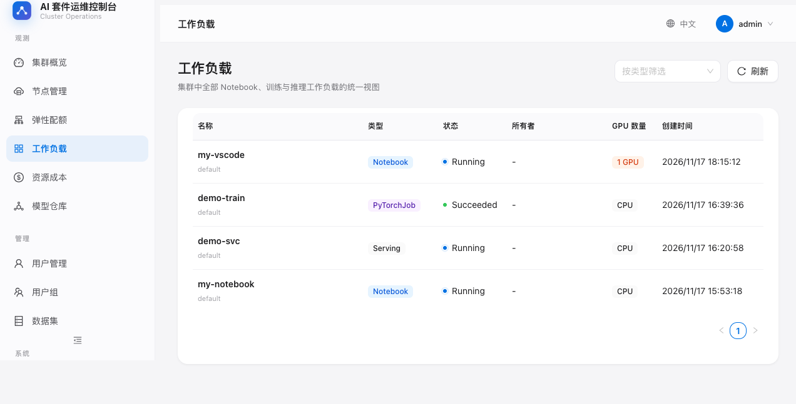

集群中全部 AI 工作负载的统一视图：**Notebook、训练任务（PyTorchJob/TFJob/MPIJob/RayJob）、推理服务**，含类型、状态、GPU 数量与创建时间，支持按类型筛选。

### 资源成本

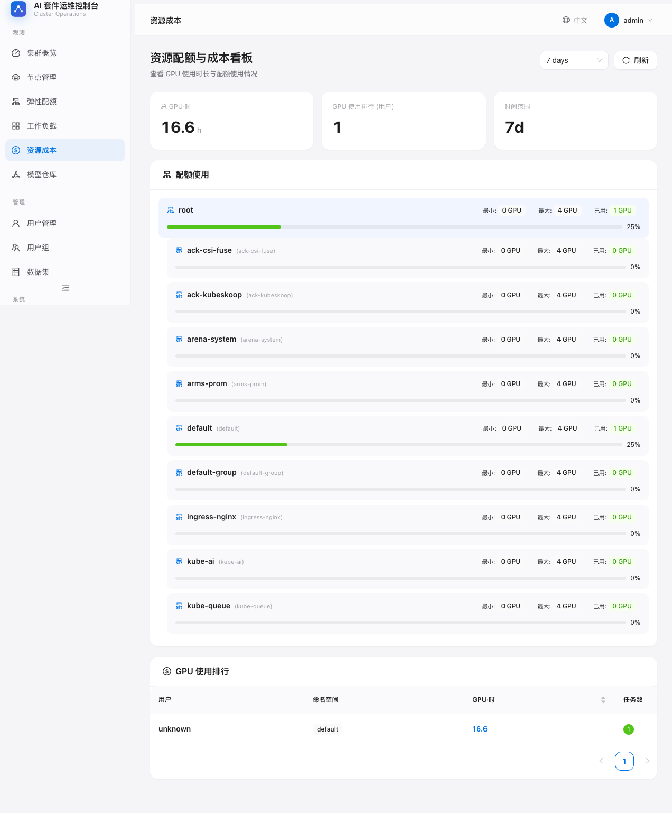

按用户/团队统计 GPU 使用时长（GPU-hours）与任务数，并结合配额树展示资源占用，辅助成本分摊与容量规划。

### 模型仓库（运维视角）

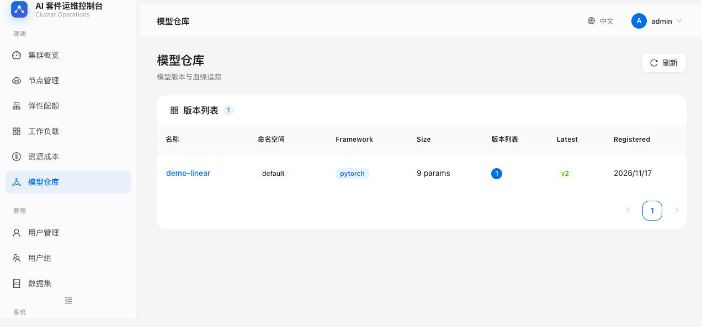

查看平台注册的全部模型及其版本、血缘（lineage），统一管理模型资产。

### 数据集

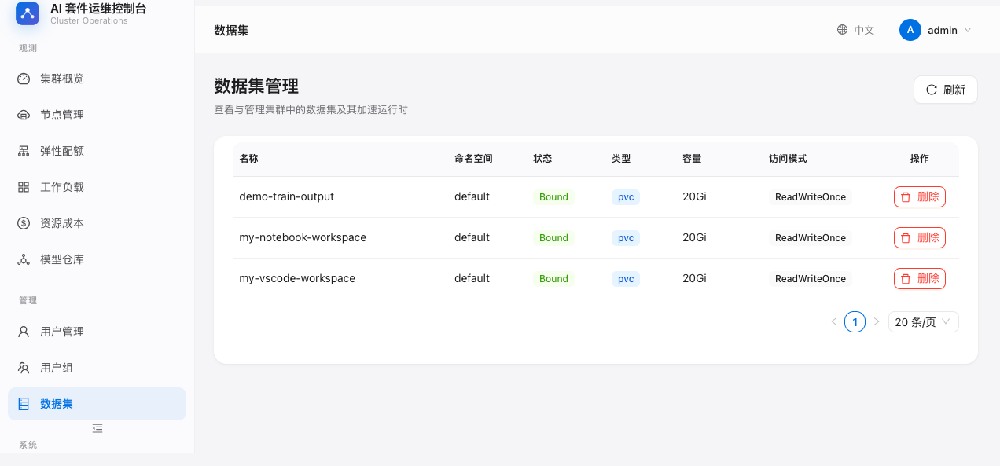

查看集群中的数据集（PVC）及其状态、容量、StorageClass 与访问模式。

### 平台设置

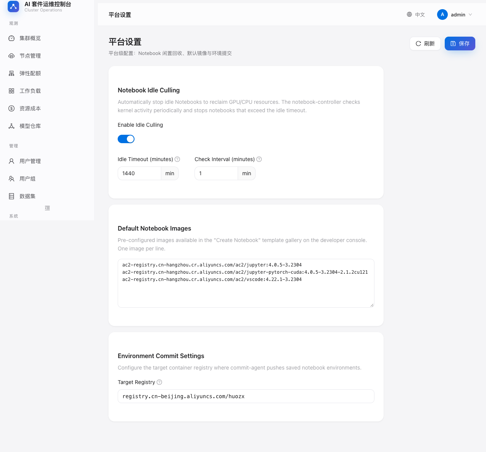

- **默认开发镜像**：Notebook/训练表单预填的镜像列表（默认 AC2 公共镜像）；
- **Notebook 闲置回收**：启用 culling、闲置时长与检查周期；
- **镜像提交仓库**：Notebook 环境提交（commit）的目标镜像仓库。

---

## 开发控制台（ai-dev-console）

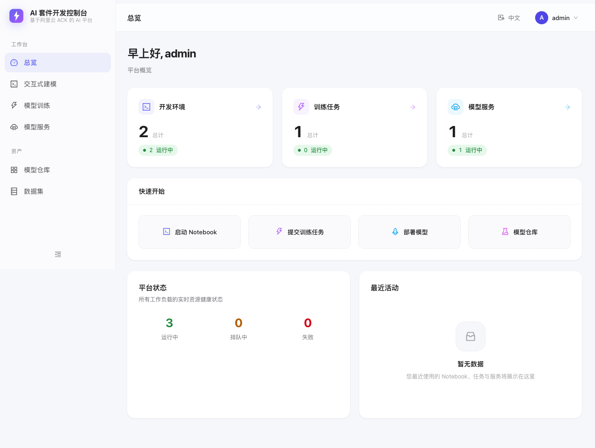

### Notebook 管理

#### 创建 Notebook

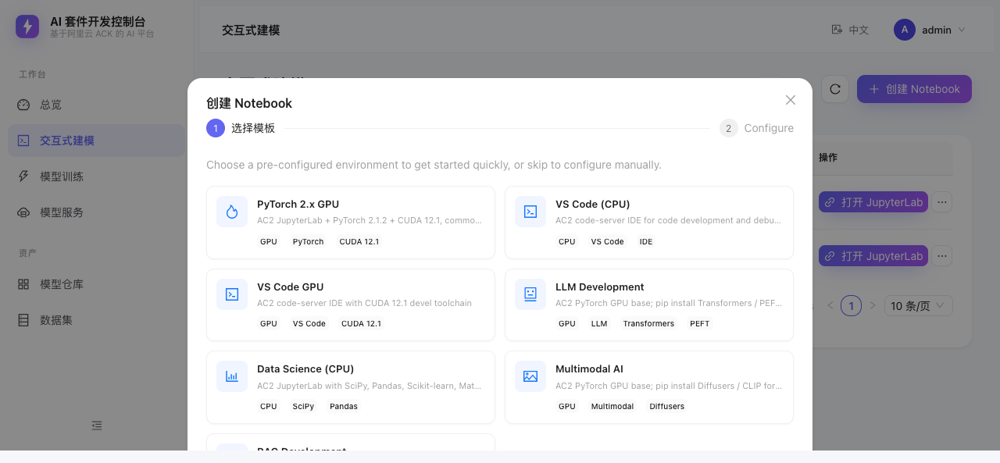

1. 进入 **交互式建模**，点击 **创建 Notebook**；
2. 选择模板（均基于 **AC2 公共镜像**，专为 ACK AI 套件设计）：
   - **PyTorch 2.x GPU**：JupyterLab + PyTorch + CUDA；
   - **VS Code (CPU/GPU)**：浏览器内 code-server IDE；
   - **Data Science (CPU)**：SciPy/Pandas/Scikit-learn；
   - **LLM Development / Multimodal AI / RAG Development**：PyTorch 基础镜像，按需 pip 安装相应库；
3. 配置资源（CPU/内存/GPU）、镜像（可自定义）、工作空间存储；
4. 点击创建，等待 Pod Running。

#### 访问 Notebook

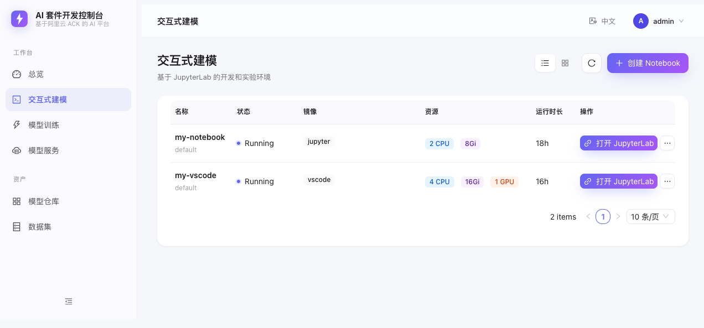

Notebook 启动后点击 **打开 JupyterLab**（或 VS Code）直接在浏览器中打开 IDE。代理访问路径：

- Jupyter：`https://<domain>/notebook/<namespace>/<name>/lab`
- VS Code：`https://<domain>/vscode/<namespace>/<name>/`

#### 生命周期管理

- **停止**：释放计算资源（含 GPU），保留 PVC 数据；
- **启动**：恢复已停止的 Notebook；
- **Resize**：调整 CPU/内存/GPU（需先停止）；
- **删除**：删除 Notebook（PVC 数据保留）。

> 列表中的状态徽标支持**悬停查看详情**：Starting 时显示镜像拉取进度，Failed 时显示具体原因（如 CrashLoopBackOff、ImagePullBackOff）。

### 训练任务

#### 提交训练任务

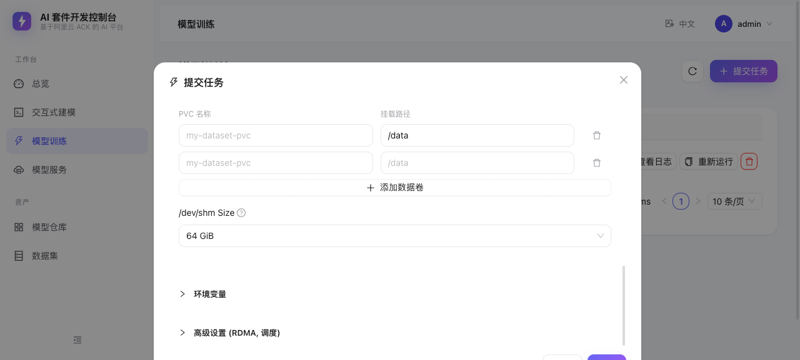

1. 进入 **模型训练**，点击 **提交任务**；
2. 选择类型：**PyTorchJob**（DDP/DeepSpeed）、**TFJob**（TensorFlow）、**MPIJob**（Horovod/DeepSpeed-MPI）、**RayJob**（KubeRay，需集群支持）；
3. 选择单机或分布式（多节点），配置每节点 CPU/内存/GPU；
4. 填写训练镜像与启动命令，或粘贴 **训练脚本**（自动挂载为 `/scripts/train.sh`）；
5. **数据挂载**：支持**多个数据卷**（PVC 名称 + 挂载路径，可动态增删），并设置 `/dev/shm` 大小；
6. 可选：环境变量、RDMA/IB 预设、调度优先级与配额组；
7. 提交任务。

#### 查看任务状态

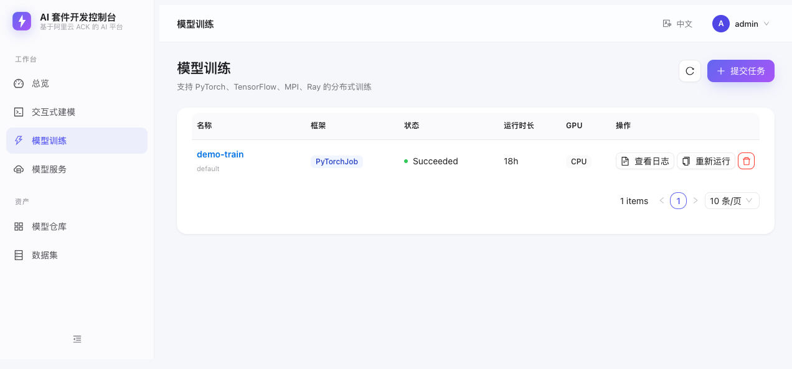

- **任务列表**：运行状态、类型、GPU 数量；
- **任务详情**：Pod 状态与事件、实时日志（多 Worker 切换）、Checkpoint 列表、YAML 定义、GPU 指标；
- 支持 **重新运行**（自动回填镜像、命令、资源与全部数据挂载）。

### 模型推理

#### 部署推理服务

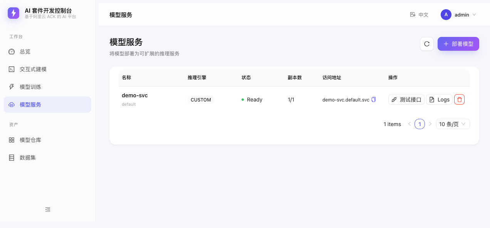

1. 进入 **模型服务**，点击 **部署模型**；
2. 选择引擎预设（**vLLM / SGLang / TGI / Triton**）或自定义镜像，配置模型路径、副本数与资源；
3. 部署后获得集群内 Service 端点（`<name>.<namespace>.svc`）。

> 推理工作负载以 Deployment + Service 部署；对 TensorFlow/PyTorch/sklearn 框架可走 KServe InferenceService（需集群安装 KServe）。

#### API Playground 测试

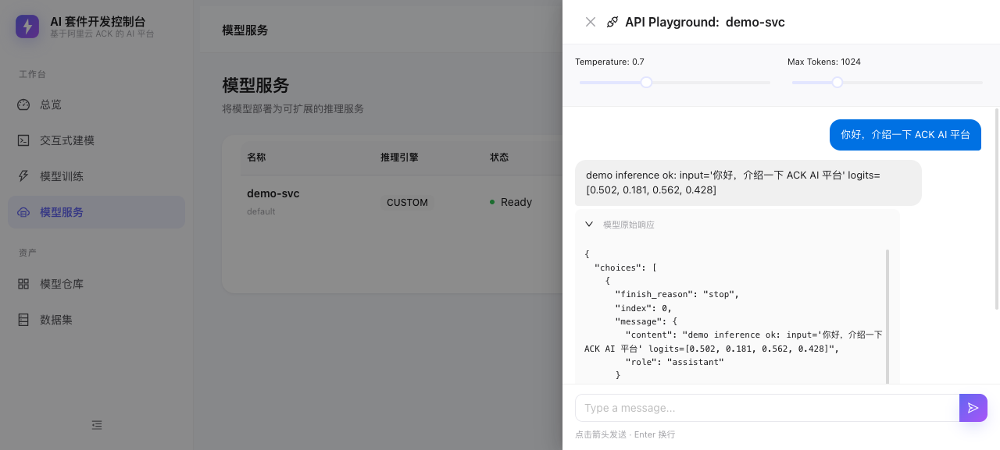

点击服务的 **测试接口** 打开 Playground：

- 调节 Temperature / Max Tokens，输入消息后**点击箭头发送**（Enter 为换行）；
- 以 OpenAI 兼容的 `/v1/chat/completions` 协议调用服务端点；
- 每条回复下方可展开 **模型原始响应**，查看端点返回的完整 JSON（choices/usage 等）。

### 模型仓库

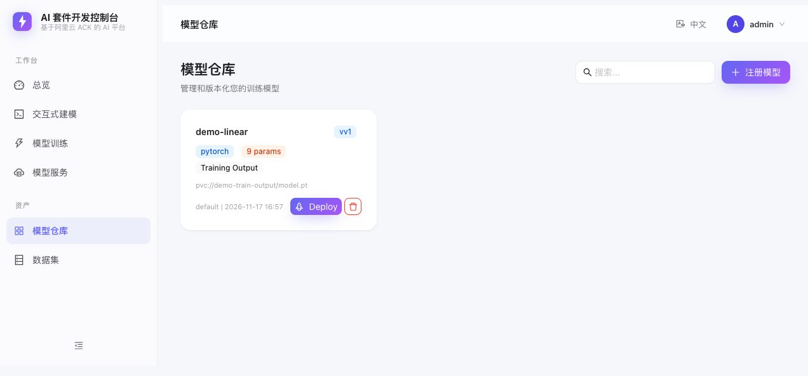

统一管理训练产出的模型：

1. **注册模型**：从训练产物（PVC 路径）、HuggingFace Hub 或 ModelScope 注册，记录框架、版本、大小；
2. **版本管理**：为模型添加多个版本；
3. **血缘**：查看模型与训练任务的关联；
4. **部署**：从模型直接发起推理服务部署。

### 数据集管理

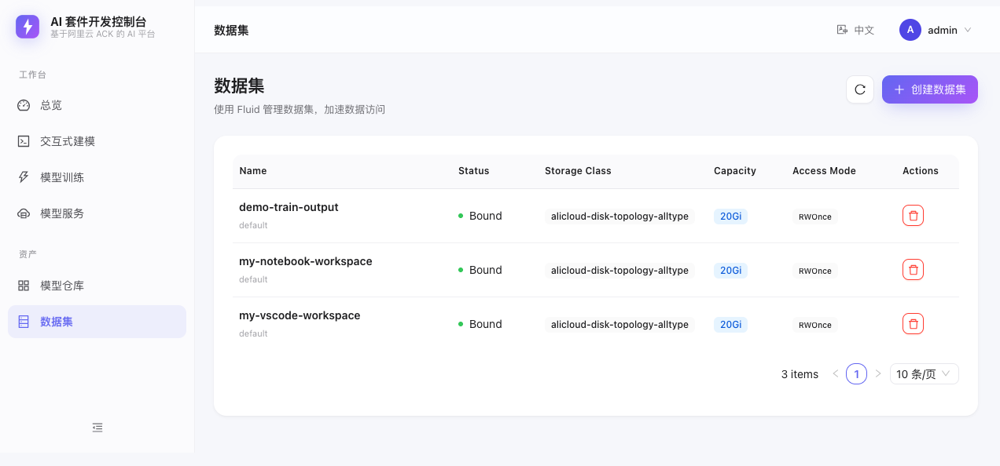

1. 进入 **数据集**，创建 PVC 数据集：选择 StorageClass（云盘/NAS/OSS）、容量与访问模式；
2. 创建后可在 Notebook / 训练任务中挂载使用。

---

## 访问方式与认证模式

| 模式 | 登录方式 | 适用场景 |
|------|----------|----------|
| `none`（默认） | 免登录，所有访问者为内置 admin | 内网 / PoC / 已有外层访问控制 |
| `aliyun` | 阿里云 RAM SSO（主账号→admin，子账号→researcher） | 生产，阿里云账号体系 |
| `custom` | 企业网关注入身份头 | 接入自有用户系统 |

详见[部署指南 · 认证模式](deploy-guide.md#auth-modes)。

> ⚠️ `none` 模式下任何能访问控制台地址的人都拥有全部权限，公网暴露务必配置访问控制。

## 权限模型

| 角色 | 能力 |
|------|------|
| admin | 所有 namespace 操作、Node Shell、用户与配额管理、平台设置 |
| researcher | 仅限分配的 namespace 内操作 Notebook / 训练 / 推理 |
