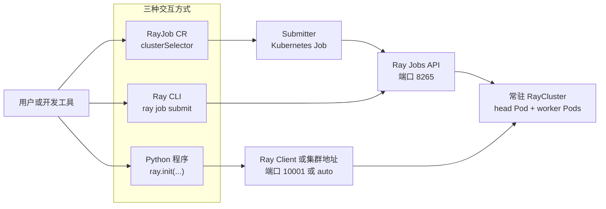
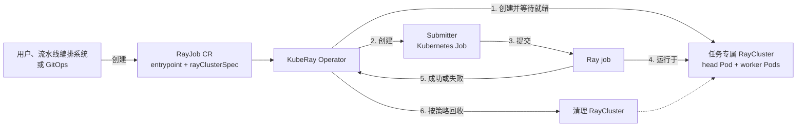

# 常驻 RayCluster 或 RayJob 任务专属集群架构选型

KubeRay 使用 Kubernetes 自定义资源（Custom Resource，CR）管理 Ray 工作负载。不同场景下，你通常需要在 `RayCluster` 和 `RayJob` 之间进行架构选择。

本文介绍这两种 CR 的职责、用户与集群的交互方式，以及适用场景。本文档推荐的架构方案如下：

- 在代码开发和调试阶段，使用 `RayCluster` 部署常驻 Ray 集群，向常驻 Ray 集群提交任务以缩短开发迭代周期。
- 生产环境离线数据处理阶段，使用 `RayJob` 创建任务专属集群，并在任务结束后回收集群。

Ray 官方在 [KubeRay 入门文档](https://docs.ray.io/en/latest/cluster/kubernetes/getting-started.html)中也推荐使用 `RayCluster` 开发 Ray 应用，并使用能够自动回收集群的 `RayJob` 降低批处理任务的资源成本。

## 核心概念

### RayCluster

`RayCluster` 描述一个 Ray 集群。KubeRay Operator 根据该 CR 创建和管理 head Pod、worker Pod、Service 和自动伸缩配置。集群创建后会持续运行，直到你删除 `RayCluster` CR。

常驻 Ray 集群将集群生命周期与单次任务生命周期分离。多个开发任务可以复用同一个集群，因此不需要为每次代码变更重新创建 head Pod 和 worker Pod。

### RayJob

`RayJob` 描述一次 Ray 应用提交。KubeRay Operator 可以通过以下任一方式运行任务：

- 使用 `clusterSelector` 将任务提交到已有的 `RayCluster`。
- 使用内嵌的 `rayClusterSpec` 创建任务专属的 `RayCluster`，等待集群就绪后提交任务，并根据清理策略回收集群。

本文使用 **`RayJob`** 表示 Kubernetes CR，使用 **Ray job** 表示提交到 Ray 集群的一次应用运行。一个 Ray job 包含同一个 driver 创建的 tasks、actors 和 objects。

## 常驻 Ray 集群

用户可以通过 `RayJob`、`ray.init()` 或 Ray CLI 使用常驻 Ray 集群。三种方式共享同一个集群，但提交入口、连接方式和任务管理能力不同。



### 方式一：使用 RayJob CR

在 `RayJob` 中设置 `clusterSelector`，让 KubeRay Operator 定位已有的 `RayCluster`。在 [`K8sJobMode`](https://docs.ray.io/en/latest/cluster/kubernetes/getting-started/rayjob-quick-start.html#rayjob-configuration) 下，Operator 创建一个 submitter Kubernetes Job，并由 submitter 调用 Ray Jobs API。`K8sJobMode` 是 `submissionMode` 的默认值；示例仍显式配置该字段，以便说明任务的提交方式。

以下示例将任务提交到标签 `ray.io/cluster: dev-raycluster` 对应的常驻集群：

```yaml
apiVersion: ray.io/v1
kind: RayJob
metadata:
  name: dev-rayjob
spec:
  entrypoint: python /workspace/main.py
  submissionMode: K8sJobMode
  clusterSelector:
    ray.io/cluster: dev-raycluster
```

确保目标 `RayCluster` 包含 `clusterSelector` 指定的标签，并且任务入口文件和依赖可以在该集群中访问。

这种方式适合需要 Kubernetes 原生声明式接口的场景。你可以使用 `kubectl`、GitOps 或工作流系统创建 `RayJob`，并通过 CR 状态查询运行结果。已有的 `RayCluster` 独立于该 `RayJob`，任务结束后继续运行。

### 方式二：使用 ray.init()

Python 程序可以调用 `ray.init()` 直接连接常驻集群。例如，集群外的交互式程序可以使用 Ray Client 地址：

```python
import ray

ray.init("ray://<head-service>:10001")
```

这种方式适合交互式开发和调试。driver 运行在提交端，并且需要与集群保持连接。对于长时间运行的离线任务，连接中断可能终止任务，因此不要将这种方式作为默认的生产提交方式。

### 方式三：使用 ray job submit

Ray CLI 通过 Ray Jobs API 将入口命令和运行时环境提交到常驻集群：

```bash
ray job submit \
  --address http://<head-service>:8265 \
  --working-dir . \
  -- python main.py
```

提交成功后，Ray 集群负责运行 driver。提交端不需要在任务运行期间保持连接，并且可以使用 `ray job status`、`ray job logs` 和 `ray job stop` 管理任务。这种方式适合开发阶段的可重复测试和手动执行。

## `RayJob` 专属集群

当 `RayJob` 包含 [`rayClusterSpec`](https://docs.ray.io/en/latest/cluster/kubernetes/references/api.html#rayjobspec) 时，用户只需要创建 `RayJob` CR。该字段定义运行任务所需的 Ray 集群模板。KubeRay Operator 负责集群创建、任务提交和资源回收。

以下示例省略了 `rayClusterSpec` 中的 head 和 worker 配置：

```yaml
apiVersion: ray.io/v1
kind: RayJob
metadata:
  name: batch-rayjob
spec:
  entrypoint: python /workspace/main.py
  # 配置RayJob运行完成后回收集群以释放资源。
  shutdownAfterJobFinishes: true
  ttlSecondsAfterFinished: 60
  rayClusterSpec:
    # 在此处填写 RayClusterSpec。具体字段已省略。
    ...
```



这种模式将集群生命周期绑定到单次任务。每个 `RayJob` 可以声明独立的镜像、Ray 版本、worker 规格和自动伸缩策略。任务结束后，KubeRay 可以删除集群并释放 CPU、内存和 GPU。

## 方案对比

下表对比常驻 Ray 集群与由 `RayJob` 创建的任务专属集群。常驻集群一列包含通过 `RayJob`、`ray.init()` 和 `ray job submit` 使用已有集群的方式。


| 对比项          | 常驻 Ray 集群                                                    | RayJob 任务专属集群                                     |
| ------------ | ------------------------------------------------------------ | ------------------------------------------------- |
| 用户入口         | `RayJob` + `clusterSelector`、`ray.init()` 或 `ray job submit` | 创建包含 `rayClusterSpec` 的 `RayJob` CR               |
| 集群生命周期       | 独立于单次任务，显式删除前持续运行                                            | 与任务绑定，任务结束后可以自动回收                                 |
| 任务运行时延       | 集群已经就绪，任务可以立即提交                                              | 需要等待 Pod 调度、镜像拉取和集群就绪                             |
| 资源成本         | 空闲时集群仍保留 head Pod 和最小数量的 worker Pod，持续占用计算资源                 | 任务完成后释放集群计算资源                                     |
| 交互调试         | 支持 `ray.init()`、Ray Client 和持续可用的 Dashboard                  | 主要通过 RayJob 状态、日志和外部可观测系统排查问题                     |
| 任务调度 - 配额管理  | Ray原生暂不支持                                                    | 与ACK ElasticQuotaTree集成，实现RayJob任务级别管理            |
| 任务调度 - 优先级调度 | Ray原生暂不支持                                                    | 与ACK Koord-Queue集成，实现RayJob任务优先级调度                |
| 隔离性 - 资源配置   | 多个任务共享集群，可能竞争 CPU、内存和 Ray object store 空间                    | 每个任务使用独立集群，各任务单独配置资源                              |
| 隔离性 - 运行环境   | 多个任务共享集群环境，不支持任务级别镜像配置。需要其他方式解决 Python 依赖管理问题。               | 每个任务可使用独立镜像配置                                     |
| 隔离性 - 故障影响   | 集群级故障可能影响同一集群中的多个任务                                          | 故障通常限制在当前 `RayJob` 创建的集群内                         |
| 可观测性 - 任务状态  | 可通过常驻 Ray 集群暴露的Dashboard查看实时任务状态，方便开发调试                      | Dashboard随Ray集群回收。需额外配置History Server持久化Ray集群事件信息 |
| 可观测性 - 日志    | Ray job运行日志可直接在提交侧查看。Ray集群系统日志可通过常驻 Ray集群暴露的Dashboard查看。     | 集群回收后现场消失，需要外部系统持久化Ray job运行日志和Ray集群系统日志          |
| 可观测性 - 监控指标  | 可通过常驻 Ray 集群暴露的Dashboard查看集群指标                               | 集群回收后现场消失，需要外部系统持久化集群监控指标                         |


## 选型建议

### 开发环境：代码开发和调试阶段

使用常驻 `RayCluster`。这种模式减少集群冷启动时间，让开发者可以反复提交代码并持续查看 Ray Dashboard。

根据交互需求选择提交方式：

- 需要 Kubernetes 原生状态和 GitOps 集成时，使用带 `clusterSelector` 的 `RayJob`。
- 需要 REPL、Notebook 或本地 Python 交互调试时，使用 `ray.init()`。保持客户端连接稳定，并避免用这种方式运行长时间离线任务。
- 需要提交后由集群独立运行、查看日志或手动停止任务时，使用 `ray job submit`。

为开发集群设置 ResourceQuota、任务资源限制和自动伸缩边界，避免单个任务耗尽共享资源。团队之间需要更强隔离时，为每个团队创建独立的开发集群。

### 生产环境：离线数据处理阶段

使用包含 `rayClusterSpec` 的 `RayJob`，让每次任务创建独立集群。该方案提供可复现的运行环境、明确的资源边界和任务级故障隔离。

生产环境还需要满足以下要求：

- 使用不可变的应用镜像，并固定镜像版本或 digest。

- 在回收集群前，将日志、指标和 Ray 事件发送到外部可观测系统。
- 设置 `shutdownAfterJobFinishes` 和适当的清理等待时间。成功任务可以较快清理；失败任务可以保留一段时间，以便排查。
- 为初始化和运行阶段设置超时，并确保任务可以安全重试。
- 与 ACK ElasticQuotaTree 和 ACK Koord-Queue 集成，管理并发任务的配额、优先级和准入。

如果任务执行时间很短、提交频率很高，并且集群启动时间占任务总时间的比例较大，可以评估生产常驻集群或预热集群池。除此之外，生产离线任务推荐使用任务专属的 `RayJob` 集群。

## 后续步骤

- [部署并使用基础 RayCluster](../1-set-up-a-basic-raycluster/README_ZH.md)
- [运行基础 Ray Job](../2-run-a-basic-ray-job/README_ZH.md)